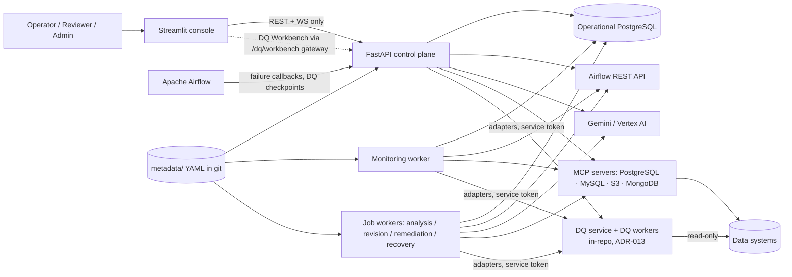
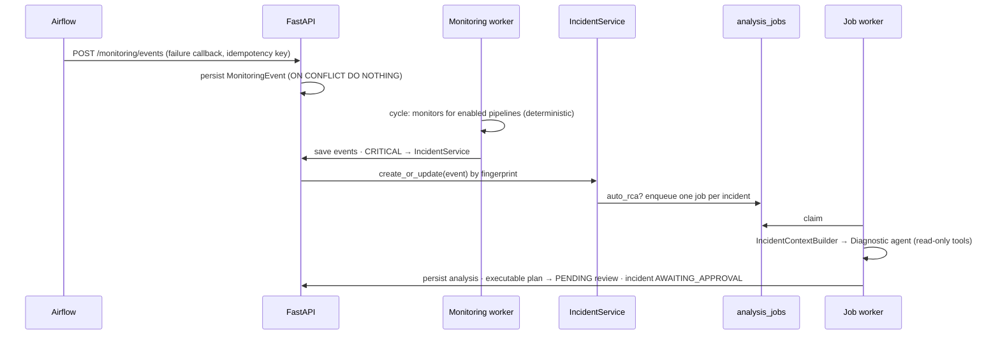
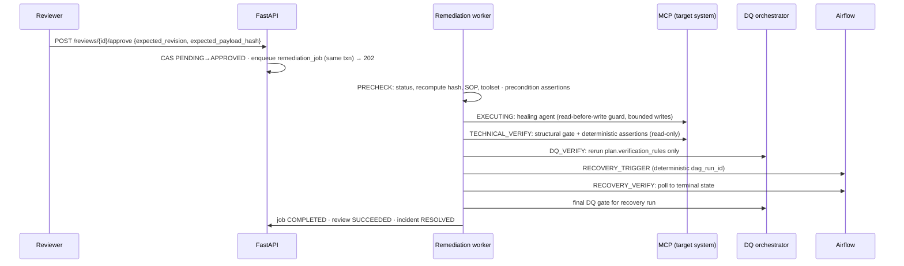

# Architecture

This document does **not** restate the source architecture. It records how the source is realized in
a greenfield build: the module map, adopted contracts and APIs, state machines, persistence,
reliability rules, the resolution of contradictions in the source (§18), and the ADRs (§19).
For behaviour detail, follow the `src §` references.

## 1. Goals and constraints

**Goals:** deterministic detection; one incident per issue; read-only AI investigation; exact-revision
human authorization; durable execution; resolution only after the full verification chain.

**Constraints:** Python 3.12, FastAPI, Streamlit, Airflow, PostgreSQL, Gemini, MCP, Pydantic
(src front-matter). No Alembic (src §0.1-8). No Jira/Confluence/vector DB in v1 (src §33.16).
Reuse DQ agents via adapters only (src §0.1-15). The 12 invariants in src §36 are binding.

**Design principles:** a modular monolith with separate worker processes; routes → services →
repositories; every external system behind a `Protocol` with an in-repo fake; deterministic code
decides, the LLM proposes, humans authorize.

## 2. System context



## 3. Module map and responsibilities

Layout follows src §0.7, §21.14 and §33.2, adjusted for greenfield. **Dependency rule:** `api → services →
(repositories | domain | integration packages)`; `domain` imports nothing from `backend`;
`frontend` imports nothing from `backend` except via HTTP.

| Path | Responsibility | Introduced |
|---|---|---|
| `backend/main.py`, `backend/app.py` | ASGI entry, `create_app()` factory, lifespan (connect pool, load metadata, init MCP manager, build agent factories). **No DDL.** | S01 |
| `backend/config.py` | `pydantic-settings` settings; environment profiles; fail-fast validation | S01 |
| `backend/observability/` | JSON logging, redaction filter, correlation-ID context, metrics | S01, S23 |
| `backend/security/` | Token auth, roles, `require_role` dependency, route inventory | S01, S23 |
| `backend/domain/` | Shared Pydantic contracts, enums, transition tables, canonical hashing | S03 |
| `backend/db/` | Async asyncpg pool, transaction helpers, migration runner and CLI | S02 |
| `backend/repositories/` | All SQL. One module per aggregate. | S02+ |
| `backend/services/` | Orchestration: diagnostic, review, revision, remediation, verification, recovery, monitoring, incident, activity, audit | S02+ |
| `backend/api/` | Thin routers per area; request/response models from `domain` | S01+ |
| `backend/metadata/` | Models, loader, validators, repository, service, connector seam, context builder | S04 |
| `backend/airflow/` | Airflow client, context provider, agent read tools, recovery trigger/wait | S05 |
| `backend/mcp/` | MCP manager, tool-permission registry, toolset composition, invocation wrapper | S06 |
| `backend/llm/` | Gemini factory, usage/cost audit callback, tool audit callback | S08 |
| `backend/agents/` | Agent construction with limits, structured output, write guard | S08, S11 |
| `backend/prompts/` | Versioned prompts and shared safety policy | S08 |
| `backend/sop/` | SOP resolver (static + runtime-approved), installation | S10 |
| `backend/dq/` | DQ contracts, `DQServiceClient`, adapters (mapping only), registry, orchestrator, verification router, baselines | S26 (client), S17, S18, S20 |
| `dq_agents/` | **DQ algorithms** (independent library): core contracts, expression DSL, connectors, DuckDB engine, the six agents, reports. Imports nothing from `backend`. | S26, S28–S33 |
| `dq_service/` | DQ service API, job queue/worker, File Manager storage, model registry, presets, schema `dq_service` migrations. Imports nothing from `backend`. | S26, S27 |
| `backend/monitoring/` | Monitors, orchestrator, health aggregation | S14 |
| `backend/jobs/` | Generic job-claim loop plus workers: revision, analysis, remediation, recovery, monitoring | S10+ |
| `frontend/` | Streamlit app, `api_client.py`, pages, components | S01, S12, S21 |
| `mcp_servers/{postgres,mysql,s3,mongodb}/` | In-repo MCP servers | S07, S24 |
| `metadata/` | Version-controlled YAML knowledge/configuration | S04 |
| `migrations/NNNN_name.sql` | Numbered SQL migrations | S02+ |
| `config/tool_permissions.yaml` | Explicit tool classification | S06 |
| `integrations/airflow/` | Callback and DQ-checkpoint helpers to install in Airflow | S13, S17 |
| `tests/{unit,contract,integration,e2e,evals}/`, `tests/fakes/` | Test layers and fakes | S01+ |
| `tools/trace.py` | Spec AC ↔ test traceability | S01 |
| `deploy/` | Compose files and Dockerfiles | S01, S22, S25 |

## 4. Process topology

| Process | Command (indicative) | Notes |
|---|---|---|
| API | `uvicorn backend.main:app` | Stateless; horizontally scalable once in-process locks are removed (all locking is in the DB). |
| Monitoring worker | `python -m backend.jobs.monitoring_worker` | Single leader via PG advisory lock. Interval + jitter. |
| Job worker(s) | `python -m backend.jobs.worker --queues revision,analysis,remediation,recovery` | N instances. Claims via `SELECT … FOR UPDATE SKIP LOCKED`. Queues can be split per process. |
| Streamlit | `streamlit run frontend/app.py` | Talks to API only. |
| MCP servers | `python -m mcp_servers.postgres` etc. | Ports 8001–8004 (src §8). Autostart by API in dev only. |
| Airflow | external | Callbacks → `POST /monitoring/events`; checkpoints → `POST /dq/run`. |
| DQ service | `uvicorn dq_service.main:app` | Internal network only; accepts the backend service token only. |
| DQ worker(s) | `python -m dq_service.worker` | CPU-heavy DQ jobs (DuckDB, scikit-learn). Scales independently of the control plane. |

## 5. Critical flows

### 5.1 Monitoring → incident → automatic RCA



### 5.2 Approval → durable execution → verification → recovery → resolution



Any failure → `FAILED` or `REPLAN_REQUIRED`. `REPLAN_REQUIRED` → Execution Replan Agent → revision N+1
(new hash, approval cleared) → fresh approval.

## 6. API catalogue (adopted)

All routes require authentication. **Role** = minimum role (Viewer < Operator < Reviewer < Admin;
`service` is a separate machine role).

| Method | Path | Role | Slice | Notes |
|---|---|---|---|---|
| GET | `/`, `/health`, `/health/ready` | none / none / Viewer | S01 | Liveness is unauthenticated. |
| GET | `/activities` · WS `/ws/activities` | Viewer | S02 | |
| GET | `/performance`, `/llm-costs` | Viewer | S08 | |
| GET | `/logs` | Admin | S23 | Redacted tail. |
| GET | `/metadata/health` | Viewer | S04 | |
| POST | `/metadata/reload` | Admin | S04 | Atomic. |
| GET | `/metadata/pipelines[/{id}]`, `/metadata/sops`, `/metadata/known-issues`, `/metadata/business-rules`, `/metadata/runbooks`, `/metadata/ownership` | Viewer | S04 | |
| GET | `/pipelines`, `/pipelines/{id}` | Viewer | S14 | Metadata summary + latest health. Read-only (ADR-007). |
| GET | `/pipelines/{id}/context` | Viewer | S05 | `static_metadata` + `airflow` (+ `dq`, `health` from later slices). |
| GET | `/airflow/dags`, `/airflow/dags/{dag_id}/runs`, `/airflow/dags/{dag_id}/runs/{run_id}/tasks` | Viewer | S05 | Proxy for UI. |
| POST | `/airflow/dags/{dag_id}/runs` | Operator | S05 | Trigger. |
| PATCH | `/airflow/dags/{dag_id}` | Operator | S05 | Pause/resume. |
| GET | `/mcp-status` | Viewer | S06 | |
| POST | `/agent` | Operator | S09 | Manual RCA. Synchronous, bounded by agent limits. |
| GET | `/analyses`, `/analyses/{id}`, `/latest-analysis` | Viewer | S09 | |
| GET | `/reviews`, `/reviews/{id}`, `/reviews/{id}/revisions`, `/reviews/{id}/audit` | Viewer | S10 | |
| POST | `/reviews/{id}/revision-jobs` | Reviewer | S10 | 202 + job ID. |
| GET | `/revision-jobs/{job_id}`, `/reviews/{id}/revision-jobs` | Viewer | S10 | |
| POST | `/reviews/{id}/approve` | Reviewer | S10/S11 | Body carries the expected revision and hash. 202 + `execution_job_id` from S11. |
| POST | `/reviews/{id}/reject` | Reviewer | S10 | |
| GET | `/execution-jobs/{job_id}`, `/reviews/{id}/execution-jobs` | Viewer | S11 | |
| POST | `/monitoring/events` | service | S13 | Idempotent ingest. |
| GET | `/monitoring/events` | Viewer | S13 | |
| POST | `/monitoring/run`, `/monitoring/pipelines/{id}/check` | Operator | S14 | |
| GET | `/monitoring/health`, `/monitoring/pipelines/{id}/health` | Viewer | S14 | |
| GET | `/incidents`, `/incidents/{id}`, `/incidents/{id}/timeline` | Viewer | S15 | |
| POST | `/incidents/{id}/dismiss` | Operator | S15 | → REJECTED with reason. |
| POST | `/incidents/{id}/analyze` | Operator | S16 | 202 + `analysis_job_id`. |
| POST | `/dq/run` | service / Operator | S17 | `wait=true` returns result within timeout, else 202. |
| GET | `/dq/runs`, `/dq/runs/{id}`, `/dq/runs/{id}/results` | Viewer | S17 | |
| GET | `/recovery-runs/{id}` | Viewer | S20 | |
| POST | `/dq/baselines` | Operator | S18 | Accept a DQ baseline (audited). |
| GET | `/dq/workbench/agents`, `/dq/workbench/files[...]`, `/dq/workbench/jobs[...]`, `/dq/workbench/models[...]`, `/dq/workbench/presets[...]` | Viewer | S34 | Gateway to the DQ service. |
| POST/PUT/DELETE | `/dq/workbench/files`, `/dq/workbench/jobs`, `/dq/workbench/presets[/{id}]` | Operator | S34 | Upload (streamed, size-limited), run jobs, manage presets. |
| POST | `/dq/workbench/jobs/{id}/narrative` | Operator | S34 | W6 grounded narrative (LLM, advisory). |

The DQ service's own internal API (`/v1/...`) is specified in `docs/dq-agents-design.md` §5. Only the backend calls it.

**Not built:** `POST /reviews/{id}/revise` (synchronous legacy; src §12), `POST/PUT /pipelines` (ADR-007).

## 7. State machines

### 7.1 Review status

`PENDING → APPROVED → EXECUTING → SUCCEEDED | FAILED | REPLAN_REQUIRED`;
`PENDING → REJECTED`; `REPLAN_REQUIRED → PENDING` (new revision only).
An accepted revision keeps the status `PENDING` and clears `approved_payload_hash`. `SUCCEEDED` is set only by
the remediation job at `COMPLETED` (after recovery and final DQ).

### 7.2 Revision / analysis job status

`PENDING → PROCESSING → COMPLETED | FAILED`. An expired lease returns the job to `PENDING`
(attempts += 1). `attempts > max_attempts` → `FAILED`.

### 7.3 Remediation job stages (src §25)

```text
QUEUED → PRECHECK → EXECUTING → TECHNICAL_VERIFY → DQ_VERIFY → RECOVERY_TRIGGER → RECOVERY_VERIFY → COMPLETED
                ↘ any stage → FAILED | REPLAN_REQUIRED
```

- `DQ_VERIFY` is recorded as `NOT_APPLICABLE` until S20, and afterwards when the plan names no
  verification rules *and* the pipeline has no required DQ rules for the checkpoint.
- `RECOVERY_TRIGGER/VERIFY` are skipped only when `plan.retry_airflow_after_success = false`. The
  incident then cannot reach RESOLVED automatically: it waits in RECOVERY_RUNNING until an operator
  confirms recovery, which is recorded (§7.5).
- **Crash rule:** a lease that expires while in `EXECUTING` → `FAILED(INTERRUPTED_DURING_EXECUTION)`,
  never re-run. Other stages resume.

### 7.4 Incident status (src §21.3, §24.1, §35.6)

| From | Allowed to |
|---|---|
| DETECTED | INVESTIGATING, REJECTED |
| INVESTIGATING | RCA_COMPLETED, FAILED |
| RCA_COMPLETED | AWAITING_APPROVAL, INVESTIGATING, REJECTED |
| AWAITING_APPROVAL | APPROVED, REJECTED |
| APPROVED | EXECUTING, FAILED, REPLAN_REQUIRED (PRECHECK finds the plan contradicted, src §25) |
| EXECUTING | VERIFYING, FAILED, REPLAN_REQUIRED |
| VERIFYING | RECOVERY_RUNNING, FAILED, REPLAN_REQUIRED |
| RECOVERY_RUNNING | RESOLVED, FAILED, REPLAN_REQUIRED |
| REPLAN_REQUIRED | AWAITING_APPROVAL, INVESTIGATING, FAILED |
| FAILED | INVESTIGATING (operator reopen) |
| RESOLVED, REJECTED | — (terminal; recurrence creates a new incident linked by `recurrence_of`) |

### 7.5 Mapping job stages → incident status

| Remediation job stage | Incident status |
|---|---|
| QUEUED, PRECHECK | APPROVED |
| EXECUTING | EXECUTING |
| TECHNICAL_VERIFY, DQ_VERIFY | VERIFYING |
| RECOVERY_TRIGGER, RECOVERY_VERIFY (incl. final DQ) | RECOVERY_RUNNING |
| COMPLETED | RESOLVED |
| COMPLETED with recovery skipped (`retry_airflow_after_success = false`) | RECOVERY_RUNNING, awaiting operator recovery confirmation; the recorded confirmation → RESOLVED |
| FAILED / REPLAN_REQUIRED (from any stage) | FAILED / REPLAN_REQUIRED |

Services apply these through `can_transition` (§7.4). The map names the target status; it never
bypasses the transition table. *(Amended 2026-09-30 during S03, product owner decision: added
APPROVED → REPLAN_REQUIRED and the recovery-skipped row, so every §7.3 edge is a legal incident
transition and RESOLVED stays reachable only from RECOVERY_RUNNING.)*

## 8. Persistence

Operational PostgreSQL. SQL only in `backend/repositories/`. Migrations follow ADR-003.

| Table(s) | Slice | Notes |
|---|---|---|
| `schema_migrations` | S02 | version, name, checksum, applied_at |
| `operation_audit`, `activities`, `agent_performance` | S02 | Audit has nullable `analysis_id`, `review_id`, `job_id`, `incident_id`, `pipeline_id`, `dag_id`, `run_id` and a server-stamped `recorded_at`. **Audit is append-only** (triggers; DELETE only after 13 months) and gets **no FKs**. Activities get an `incident_id` FK in S15. |
| `analyses` | S09 | Partial unique index on scope where `status='RUNNING'` |
| `remediation_reviews`, `remediation_review_revisions`, `review_revision_jobs`, `approved_sops` | S10 | Partial unique index for active scope (PENDING/APPROVED/EXECUTING). Revisions are insert-only (trigger blocks UPDATE/DELETE). |
| `remediation_jobs` | S11 | Unique `(review_id, revision)`. Lease columns. |
| `monitoring_events` | S13 | Unique `idempotency_key`. Append-only. |
| `pipeline_health` | S14 | Latest snapshot per pipeline (upsert) |
| `incidents`, `incident_events`, `incident_transitions` | S15 | Partial unique `incident_key` where not terminal. Adds `incident_id` FKs to analyses/reviews/audit/activities. |
| `analysis_jobs` | S16 | One active job per incident |
| `dq_runs`, `dq_results` | S17 | Unique request key per run |
| `verification_results` | S19 | Per assertion/rule, per job stage |
| `recovery_runs` | S20 | original/recovery run IDs, final DQ status |
| `dq_baselines` | S18 | Accepted baseline job per pipeline/dataset/agent |
| schema `dq_service`: `files`, `file_versions`, `jobs`, `job_results`, `artifacts`, `models`, `model_versions`, `presets` | S26, S27 | Owned by the DQ service. Separate migration directory run by the same runner, extended in S26 with `--schema dq_service` and a per-schema tracking table. The backend never queries it. |

**Retention:** per use-case-spec §7, implemented as a scheduled purge job in S25.

## 9. Background processing

One generic job pattern (ADR-004), implemented once in `backend/jobs/base.py` (S10) and reused:

- **Claim:** `UPDATE … SET status='PROCESSING', lease_owner=$w, lease_expires_at=now()+$lease
  WHERE id = (SELECT id … WHERE status='PENDING' AND available_at<=now() ORDER BY created_at
  FOR UPDATE SKIP LOCKED LIMIT 1) RETURNING *`.
- **Heartbeat:** extends the lease while a stage runs. **Reaper:** returns expired leases to PENDING,
  or applies the stage-specific crash rule (§7.3).
- **Idempotency:** natural unique keys (review+revision, incident active job, DQ request key) make
  enqueueing idempotent. Workers make stage transitions with compare-and-set on `(id, stage, version)`.
- **Retries:** transient errors retry with exponential backoff up to `max_attempts`. Writes are never
  auto-retried.

## 10. Authentication and authorization

- **v1 (S01):** bearer tokens mapped to `{subject, role}` from a secret-provided file or environment
  variable (`API_TOKENS_FILE`). Streamlit sends the signed-in user's token. The Airflow integration uses a `service` token.
- **S23:** OIDC for Streamlit and the API (per OQ-05), route-inventory test ensuring every route declares a role,
  rate limits on `/monitoring/events` and `/agent`.
- **Actor attribution:** every mutating service call takes an `Actor` (subject, role) and it is persisted in
  audit, transitions and approvals.

| Capability | Viewer | Operator | Reviewer | Admin | service |
|---|---|---|---|---|---|
| Read health, metadata, incidents, analyses, reviews, audit | ✔ | ✔ | ✔ | ✔ | — |
| Trigger/pause DAG, start RCA, run monitoring, dismiss incident | — | ✔ | ✔ | ✔ | — |
| Revise, approve, reject review | — | — | ✔ | ✔ | — |
| Reload metadata, read logs | — | — | — | ✔ | — |
| Ingest events, run DQ checkpoint | — | — | — | — | ✔ |

## 11. Agent, model and tool boundaries (summary; detail in `docs/agent-design.md`)

- The toolset is composed **deterministically** per agent from the permission registry (ADR-005).
- The diagnostic agent gets read tools plus Airflow read tools. No-tool agents: revision, SOP generation, replan.
- The healing agent gets the approved target system's tools plus Airflow read tools, wrapped by the **write guard**:
  a write requires a prior read on the same system in this job, and the number of writes ≤ the plan's declared operations.
- No agent can trigger Airflow or run DQ. Recovery and verification are worker code (ADR-010, ADR-011).
- Monitoring code has no LLM dependency (asserted by test).

## 12. Configuration and secrets

- `pydantic-settings` with `ENV ∈ {dev, test, prod}`. `.env.example` lists every key, with no secret values.
- Secrets (DB passwords, Airflow credentials, Gemini/Vertex credentials, API tokens, MCP DB roles)
  come only from the environment or a secret manager. Production startup fails if any is missing or looks like a
  dev default.
- Non-secret config families: Airflow, operational DB pool, Gemini models/prices, agent limits,
  MCP endpoints, monitoring interval, job leases, timeouts, CORS allowlist, metadata dir.

## 13. Reliability — timeouts, retries, idempotency

| Call | Timeout *(proposed default)* | Retry |
|---|---|---|
| Airflow GET | connect 5 s / read 30 s | 3× exponential backoff on connect errors, 5xx, 429 |
| Airflow trigger (recovery) | 30 s | Idempotent by deterministic `dag_run_id`; a 409 means "look up existing run" |
| MCP tool call | 60 s (per-tool override in registry) | Read tools: 2×. Write tools: **never** |
| Gemini call | 120 s | 2× on transient errors; one repair retry on schema-invalid output |
| DB statement | 30 s (`statement_timeout`) | Serialization/deadlock errors: 3× |
| DQ adapter → DQ service | HTTP 30 s per call; job wait `DQ_SYNC_TIMEOUT_S` (default 300 s) | Submit is idempotent on `request_key`; polling retries on transient errors |
| DQ job (inside DQ service) | `DQ_JOB_TIMEOUT_S` 900 s; DB statement 60 s | Lease reclaim; `max_attempts` 3 (jobs are read-only, so re-running is safe) |
| Recovery wait | `max_runtime_minutes × 1.5` from metadata, default 90 min | Poll every 30 s |
| Job lease | revision/analysis 5 min, remediation 10 min, heartbeat every lease/3 | Reaper every 30 s |

## 14. Observability

- **Logs:** JSON with `request_id`, and when present `incident_id, pipeline_id, dag_id, run_id, task_id,
  analysis_id, review_id, job_id, stage` (src §29). A redaction filter runs on all handlers.
- **Audit:** `operation_audit` for tool calls, model calls, human decisions, stage and state transitions.
- **Metrics (S23):** monitor cycles/duration, events by source/severity, incidents created/deduplicated,
  RCA latency, approval latency, remediation success, verification failures, recovery success, LLM
  tokens/cost, job queue depth/age.
- **Tracing:** OpenTelemetry optional (S23), with span attributes matching the log fields.

## 15. Deployment and environments

| Env | Purpose | Externals |
|---|---|---|
| `test` | CI unit/contract | Fakes only |
| `dev` | Local | `deploy/docker-compose.dev.yml`: operational PG, MySQL source, PG target, MCP servers; fake or real Airflow |
| `e2e` | Canonical scenario | `deploy/docker-compose.e2e.yml`: plus Airflow standalone with `customer_daily_load` DAG |
| `prod` | Per OQ-07 | Secret manager, managed PG, restricted CORS, OIDC |

## 16. Scaling and cost

- v1 targets tens of pipelines. The PG job queue and a single monitoring leader are sufficient. Revisit at
  more than 500 pipelines or more than 20 concurrent remediation jobs (ADR-004 exit criterion).
- LLM cost controls: per-agent model choice, token budget per run, output-char limits, cost audit,
  no LLM in monitoring, statistical/anomaly DQ only on schedule.

## 17. Threats and mitigations (summary; full review in S23 `docs/security-review.md`)

| Threat | Mitigation |
|---|---|
| Prompt injection via logs, data values, metadata or human edits | Delimited untrusted sections; toolset fixed before the run; write tools absent in diagnosis; deterministic plan validation; evals E-INJ |
| Approval bypass or stale approval | CAS approve with expected hash; re-hash at PRECHECK and before first write; unique active review |
| Tool privilege escalation | Default-deny registry; target-scoped execution toolset; write guard; DB roles (read-only role for read tools) |
| Excessive autonomy / runaway loops | Tool/model/recursion/token limits; no Airflow trigger tool; bounded writes |
| Destructive DML | Server-side WHERE requirement, `max_affected_rows` with rollback, approved assertions |
| Data leakage to LLM or logs | Sample caps, PII masking, redaction, no secrets in prompts |
| Replay/duplicate effects | Idempotency keys, unique constraints, deterministic recovery run IDs |
| Unauthorized UI/API actions | RBAC per route; actor attribution; admin-only reload/logs |
| Supply chain | Pinned lockfile (`uv.lock`), `pip-audit` in CI (S23) |
| Malicious file upload (zip bomb, type confusion, formula injection) | Size and decompression caps, magic-byte sniffing, format allowlist, canonical Parquet conversion, export escaping (S27) |
| Code execution via DQ expressions or model artifacts | Safe-expression AST allowlist; DuckDB external access disabled; no user pickles; HMAC-signed service-trained models (S26, S27, S33) |
| DQ service misuse | Internal network, backend-only service token, read-only DSNs, per-job resource limits (S26) |

## 18. Reconciled contradictions in the source architecture

| # | Source conflict | Resolution |
|---|---|---|
| C1 | Incident statuses (src §21.3) vs. `TECHNICAL_VERIFY / DQ_VERIFY / RECOVERY_VERIFY` shown as incident states (src §35.6) | Incident uses src §21.3 statuses. The finer states are **remediation job stages** (src §25). Mapping in §7.5. |
| C2 | `pipelines` table and `POST/PUT /pipelines` (src §21.8, §27, §35.7) vs. static YAML pipeline registry (src §33) | YAML is the only pipeline registry. No `pipelines` table, no write APIs in v1 (ADR-007). `pipeline_health` stores runtime health only. |
| C3 | `SOP.txt` append-on-approval (src §9.1) vs. `metadata/sops/*.yaml` (src §33) | Static SOPs in YAML. Runtime-approved SOPs in `approved_sops`. No `SOP.txt` (ADR-008). |
| C4 | Health path `/pipelines/{id}/health` (src §35.7) vs. `/monitoring/pipelines/{id}/health` (src §21.7, §26) | `/monitoring/pipelines/{id}/health` is canonical. `/pipelines/{id}` includes the latest health summary. |
| C5 | Context path `/metadata/pipelines/{id}/context` (src §35.7) vs. `/pipelines/{id}/context` (src §33.13) | `/pipelines/{id}/context`, because the combined context is not purely metadata. |
| C6 | `MonitoringEvent` / `PipelineHealthResult` field sets differ (src §21.3 vs. §22.2) | Union: `event_id`, `idempotency_key`, `checked_at`/`evaluated_at` → `evaluated_at`, and `monitor_status` kept. |
| C7 | Review becomes SUCCEEDED after the recovery *trigger* (src §14.3) vs. invariant 7 | SUCCEEDED only at job `COMPLETED` (recovery terminal success + final DQ). |
| C8 | Synchronous `/approve` (src §12) vs. durable jobs (src §25) | Durable from the start: approve → 202 (ADR-004). |
| C9 | DQ profile shapes differ (src §23.3 list of `{agent, enabled, blocking}` vs. src §33.4 short lists); agent names `recon` vs. `reconciliation` | Canonical YAML: per-checkpoint list of `{agent, enabled, blocking, rules?, schedule?}`. Logical names `custom_dq, recon, profiling, statistical, anomaly, preprocessing`. |
| C10 | Human-input endpoint "assumed elsewhere" (src §4.4) | Out of scope for v1 (OQ-09). |
| C11 | Diagnostic RCA synchronous `POST /agent` vs. durable incident RCA | Keep `POST /agent` synchronous (bounded) for the manual flow. Incident RCA uses `analysis_jobs`. Both call the same `DiagnosticService`. |
| C12 | DQ brief's File Manager "Pipeline Settings" vs. git-governed pipeline metadata (ADR-007) | Governed pipeline DQ configuration stays in `metadata/` (shown read-only). "Pipeline Settings" become versioned **workbench presets** that never affect governed monitoring or checkpoints. |
| C13 | Source premise "existing DQ agents are external; do not recreate their algorithms" (src §0.1-15, invariant 10) vs. greenfield request to build the DQ suite | Build the DQ suite in-repo as an **independent service** (ADR-013). The backend keeps zero DQ algorithms and uses adapters only, so invariant 10 holds at the platform boundary. Pre-existing implementations are ported, not rewritten (OQ-16). |

## 19. Architecture Decision Records

Format: **Decision · Context · Consequences · Status.** ADR-001 to ADR-015 were **Accepted** at G2 on 2026-09-30.
ADR-016 was accepted on 2026-10-01 during S04 (product owner).
ADR-014 was amended on 2026-09-30 (product owner decision): file contents live on a local Docker volume, not an
object store.

**ADR-001 Greenfield interpretation.** Build CURRENT capabilities as baseline and documented gaps directly in
target form (see `docs/sdd-workflow.md` §2). *Context:* no existing code. *Consequences:* no
compatibility shims or dual paths; the source "move first" guidance does not apply. Invariants still bind.

**ADR-002 Technology stack** *(amended 2026-09-30: PostgreSQL driver)*. Python 3.12, `uv` (lockfile),
FastAPI, Pydantic v2, pydantic-settings, **asyncpg** (async driver + pool), httpx, PyYAML (safe_load),
Streamlit, LangChain agents with `langchain-google-genai` and `langchain-mcp-adapters`, the official
`mcp` SDK (FastMCP, streamable HTTP) for servers, `sqlglot` for SQL read-only validation. Tests: pytest,
pytest-asyncio, pytest-timeout, respx; lint/type: ruff, mypy (with `asyncpg-stubs`).
*Consequences:* exact versions pinned in S01. LangChain agent APIs are version-sensitive, so S08 pins
them and wraps them behind `backend/agents/factory.py`.
*Amendment (S02):* psycopg 3 was replaced by asyncpg. On the development machine, Windows Smart App
Control (enforcing) blocks psycopg-binary's bundled, unsigned libpq DLL, while asyncpg loads normally.
asyncpg also runs on Windows' default Proactor event loop, which psycopg's async mode cannot, so no
uvicorn loop workaround is needed. Queries use `$n` placeholders. Repositories accept either a direct
or a pooled connection (`backend.db.pool.Connection`). *Rejected:* psycopg with the local PostgreSQL
libpq via PATH (fragile per-shell setup); developing inside WSL/Docker only; disabling Smart App Control.

**ADR-003 Numbered SQL migrations with an in-repo runner.** `migrations/NNNN_name.sql`, table
`schema_migrations(version, name, checksum, applied_at)`, advisory lock, refuses edited applied
files. The app never runs DDL; readiness reports pending migrations. *Rejected:* Alembic (src §0.1-8),
startup DDL (src §16 gap).

**ADR-004 PostgreSQL-backed durable jobs + separate worker processes.** `SKIP LOCKED` claim, leases,
heartbeats, reaper, stage CAS. *Rejected for v1:* Celery/Redis/RQ/Arq (extra infra without need).
*Exit criterion:* revisit at more than 20 concurrent remediation jobs or more than 500 pipelines.

**ADR-005 Explicit tool-permission registry, default deny.** `config/tool_permissions.yaml` classifies every
MCP tool as `read` or `write` (with per-tool timeout and notes). Unknown tools are unusable. A name-heuristic
mismatch is flagged and the tool excluded. *Rejected:* name heuristics as the primary classifier (src §8.1 limitation).

**ADR-006 Approval is compare-and-set on the reviewer-supplied revision and hash.** The approve request carries
`expected_revision` and `expected_payload_hash`. The hash is re-verified at PRECHECK and immediately
before the first write. *Consequence:* a reviewer can never approve something they did not see.

**ADR-007 Static YAML is the pipeline registry.** No `pipelines` table or pipeline write APIs in v1.
Changes to pipelines go through git review. *Consequence:* resolves C2. Runtime health is stored separately.

**ADR-008 SOP catalogue = static YAML + DB `approved_sops`.** Runtime-approved generated SOPs are stored
with approver, review ID, risk, target system and SHA-256. They are merged by `SOPResolver`. An export
command can promote them to YAML via PR. *Rejected:* runtime writes to `SOP.txt` or to git-tracked files.
*Pending:* OQ-06.

**ADR-009 Streamlit talks only to FastAPI.** Airflow operator actions are proxied by `/airflow/*` routes.
*Consequence:* one auth and audit point. Streamlit has no Airflow credentials.

**ADR-010 Verification assertions are typed data in the approved plan, evaluated deterministically.**
`RemediationPlan.verification_plan.assertions` (e.g. `duplicate_count`, `row_count`, `sql_scalar`,
`object_exists`, `document_count`) are hashed and approved with the plan, then executed via read-only
tools by `VerificationService` with no LLM. An executable plan requires at least one assertion.
*Consequence:* "tool call success" is never treated as verification (invariant 6).

**ADR-011 Recovery is deterministic worker code.** Recovery trigger (idempotent `dag_run_id =
recovery__{review_id}__r{revision}`) and terminal wait run in the remediation/recovery worker. No agent
holds an Airflow trigger tool.

**ADR-012 Every external dependency sits behind a Protocol with an in-repo fake.** `AirflowClient`, `MCPManager`,
chat model, DQ adapters and clock. CI needs no external services. Integration/E2E layers use
Docker. Live-LLM evals run on demand or nightly.

**ADR-013 The DQ agent suite is an independent in-repo service.** The `dq_agents` library and `dq_service`
(API + workers + schema `dq_service` + local file-storage volume) implement File Manager, Preprocessing, Profiling, Custom DQ,
Recon, Statistical Check and Anomaly Detection. No imports cross between the backend and the DQ packages. The only coupling is
the versioned `/v1` HTTP API with consumer contract tests. The DQ service has no LLM dependency.
*Context:* the user requested these agents for this greenfield project (2026-09-30), which resolves OQ-01.
*Consequences:* CPU-heavy DQ work is isolated and scales separately. Invariant 10 is preserved at the platform boundary.
Adds one service and one worker to deploy. *Rejected:* embedding DQ code in the backend (violates invariant 10 and
couples control-plane availability to heavy compute); invoking agents through MCP (not designed for bulk data).

**ADR-014 File Manager storage and artifact trust** *(amended 2026-09-30)*. Uploads are stored as immutable,
SHA-256-addressed versions, converted to canonical Parquet, on a **local Docker volume** (`dq-storage`) mounted by the DQ
service and DQ workers on the same host. Layout: `files/<file_id>/v<n>.parquet` (plus the original upload) and
`artifacts/<kind>/<id>`. Metadata (files, versions, lineage, presets, model registry) is in schema `dq_service`.
All access goes through a `FileStorage` protocol (`LocalVolumeStorage` now), so a later move to S3 is a config change
plus an implementation, not a redesign. Model artifacts are produced only by the service, HMAC-signed and verified
before load. External model uploads are not supported in v1 (OQ-14).
*Context:* the deployment is Docker Compose on a single VM (OQ-07), so an object store is extra infrastructure without
a benefit yet. *Consequences:* the DQ service and workers must run on the same host (or share the volume). Backups
must include the volume alongside Postgres (S25). Horizontal scaling across hosts requires switching to S3 first.
*Rejected:* MinIO/S3 now (extra service to operate at v1 scale); file bytes in Postgres (DB bloat, slow backups);
loading uploads into Postgres tables (slow for 20M-row files); loading user-supplied pickles (RCE).

**ADR-015 DQ compute strategy: SQL-first via sqlglot + DuckDB, numeric/ML on bounded samples.** Deterministic
tabular work (rules, profiling aggregates, preprocessing steps) is a validated AST compiled per dialect. It is pushed
down to PostgreSQL/MySQL, or executed in sandboxed DuckDB for files and S3 objects. Cross-system recon hashes rows in
DuckDB after extraction to avoid dialect formatting drift. Statistical and ML algorithms (scipy, scikit-learn) run on
seeded samples with the sampling recorded. *Rejected:* pandas-only full loads (memory-bound, not exact at scale);
Spark (infrastructure overhead at v1 volumes, OQ-18).

**ADR-016 SOP content hash covers behavioural fields only** *(accepted 2026-10-01, product owner, during S04)*.
`SOPReference.content_sha256` pins the SOP an approval relied on. It is
`backend.domain.hashing.sop_content_sha256(sop_id, sop)`, the SHA-256 of the canonical JSON of
`{sop_hash_version: 1, sop_id, title, category, target_system, risk_level, required_evidence,
remediation_steps, verification_steps, stop_conditions}`. *Context:* hashing the whole catalogue
document made cosmetic edits (tags, `pipeline_ids`, version labels) invalidate approvals already in
flight, and static YAML SOPs and runtime-approved SOPs (`approved_sops`, ADR-008) would have used
different hash domains. *Consequences:* both SOP sources share one hash, and catalogue edits leave the pin
unchanged. A SOP that becomes DEPRECATED is caught by an explicit status check at PRECHECK (S11), not by
the hash. Changing the field list or the version marker needs a new ADR. *Rejected:* hashing the full YAML
document; hashing only `remediation_steps`, which would miss changed stop conditions or scope.

## 20. Alternatives rejected

| Alternative | Why rejected |
|---|---|
| Microservices per domain (monitoring, incidents, DQ) | Premature; the modular monolith plus workers gives the same boundaries at lower cost. |
| LLM-based anomaly or failure detection in monitoring | Violates src §22.1 and invariant 3 (deterministic detection). |
| Vector DB / RAG over runbooks | Explicitly deferred (src §33.16). Deterministic retrieval by pipeline/category first. |
| Letting the healing agent trigger the Airflow recovery | Removes a deterministic verification gate; widens agent privileges. |
| Storing pipelines in DB with a CRUD UI | Duplicates the git-governed registry (C2). |
