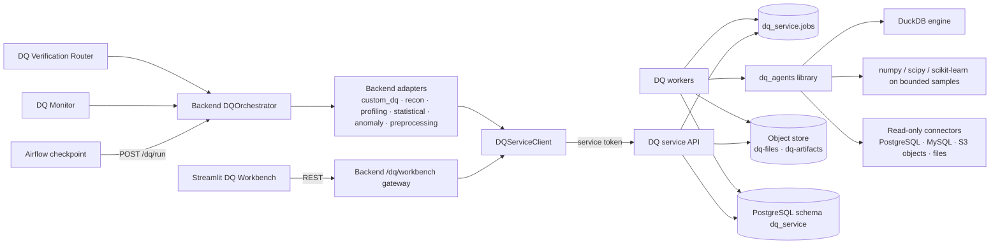

# DQ Agent Suite — Design

The platform needs seven data-quality capabilities: **File Manager, Data Preprocessing, Data
Profiling, Custom DQ, Data Recon, Statistical Check and Anomaly Detection.** The source
architecture assumed these already exist outside the repo (src §17). This repository is greenfield,
so they are built here as an **independent DQ service** (ADR-013). The self-healing control plane
still reaches them only through adapters (S17/S18). This keeps invariant 10 at the platform boundary:
the backend never contains a DQ algorithm.

> If implementations of these agents already exist elsewhere (OQ-16), port their algorithms into
> `dq_agents/` behind the contracts below instead of rewriting them. The slice specs stay the same.
> Only the implementation notes change.

## 1. Two ways the suite is used

| Mode | Who | Data | Entry point | Output |
|---|---|---|---|---|
| **Workbench** (interactive) | DQ analyst / operator in Streamlit | Uploaded files, registered tables | Backend gateway `/dq/workbench/*` → DQ service | Reports, derived datasets, trained models |
| **Platform** (governed) | Airflow checkpoints, DQ monitor, verification router | Pipeline source/target tables from metadata | Backend `DQOrchestrator` → adapters → DQ service | `DQAgentResult` → `dq_results` → MonitoringEvents / verification |

Both modes run the same agent code and produce the same result contract.

## 2. Components



| Package | Responsibility | Depends on |
|---|---|---|
| `dq_agents/core/` | Contracts, `DatasetRef`, fingerprinting, masking, safe-expression DSL, rule compiler, sampling, reports | stdlib, pydantic, sqlglot, duckdb, pyarrow |
| `dq_agents/io/` | Read-only connectors: file versions (object store), PostgreSQL, MySQL, S3 objects | core |
| `dq_agents/agents/{preprocessing,profiling,custom_dq,recon,statistical,anomaly}/` | Algorithms. Pure functions of (inputs, params, seed) → `AgentRunResult` | core, io, numpy, scipy, scikit-learn |
| `dq_agents/reports/` | JSON canonical report → HTML (autoescaped Jinja2) / Markdown | core |
| `dq_service/api/` | FastAPI: files, jobs, models, presets, agent catalog, health | dq_agents |
| `dq_service/jobs/` | Durable job queue and worker (same pattern as ADR-004) | dq_agents |
| `dq_service/storage/`, `repositories/`, `migrations/` | Object store and schema `dq_service` | — |

**Boundary rules:** `dq_agents` and `dq_service` import nothing from `backend`, and `backend` imports nothing from
them. The only coupling is the DQ service HTTP API (versioned `/v1`). `dq_agents` has **no LLM dependency**.

## 3. Agent catalog

| Agent | Operations | Methods | Primary output | Platform checkpoint | Blocking by default |
|---|---|---|---|---|---|
| **File Manager** (service capability) | upload, version, preview, delete, model registry, presets | type sniffing, schema inference, SHA-256 versioning | `FileVersion`, `Preview`, `ModelVersion`, `Preset` | — | — |
| **Data Preprocessing** | clean, transform, normalize, integrate | DuckDB SQL from a validated step spec; fitted normalization params | New derived `FileVersion` + lineage | Prerequisite only | — |
| **Data Profiling** | profile, compare | Exact aggregates in DuckDB/pushdown; histograms; normality; PSI/KS vs baseline | `ProfileReport` + profile hash | SOURCE, TARGET | No |
| **Custom DQ** | run_rules, quick_validate | Rule catalog compiled to SQL (pushdown to PG/MySQL; DuckDB for files) | Per-rule findings with failed counts and masked samples | SOURCE, TARGET | Yes (for rules marked blocking) |
| **Data Recon** | reconcile | Aggregate cross-verification; key alignment via key+row-hash in DuckDB; bucketed checksums | Count/alignment/mismatch findings + resolution suggestions | RECONCILIATION | Yes |
| **Statistical Check** | run_checks | MAD / robust z, IQR, z-score, KS / χ² / Mann-Whitney (BH-corrected, with effect sizes), skew/kurtosis, PCA reconstruction error, KNN distance, factor analysis congruence | Per-check findings with statistics and thresholds | SCHEDULED / on trigger | No |
| **Anomaly Detection** | train, score, detect_patterns | Isolation Forest (+ LOF), supervised gradient boosting / random forest, STL residual + robust z on metric series | Scores, flags, top-N explanations, model versions | SCHEDULED / on trigger | No |

## 4. Data access and execution strategy (ADR-015)

- **`DatasetRef`** (discriminated union): `file` {file_id, version} · `table` {system: postgresql|mysql,
  database, schema, table} · `s3_object` {bucket, key, format}. MongoDB collections are out of scope for v1 (OQ-17).
- **Connections:** table refs resolve through `DQ_CONNECTIONS` (secret-provided map `system:database → read-only DSN`).
  The DQ service never holds write credentials.
- **Deterministic tabular work runs as SQL.** Custom DQ rules, profiling aggregates and preprocessing
  steps are expressed as a validated AST (sqlglot), compiled to the target dialect, and executed:
  - on **PostgreSQL/MySQL** tables by pushdown (exact results, no bulk extraction);
  - on **files and S3 objects** in **DuckDB** (Parquet/CSV/JSON read natively).
- **Cross-system recon:** aggregates are pushed down per side. Keys and selected compare columns are streamed in
  chunks into DuckDB temp tables. Row hashes are computed **in DuckDB** after extraction, so dialect formatting
  differences cannot cause false mismatches. For large tables, a bucketed checksum pass (`hash(key) % N`)
  runs first and only mismatched buckets are drilled into.
- **Statistical and ML work** runs on bounded samples loaded into numpy/pandas (`DQ_MAX_SAMPLE_ROWS`).
  The sampling method and size are recorded in every result.
- **Masking:** columns listed as PII (pipeline `datasets[].pii_columns`, or declared at upload) are masked in
  every sample, top-k list, preview and report.

## 5. Contracts (DQ service API `/v1`)

```text
AgentRunRequest  { agent, operation, inputs: [DatasetRef], params: dict, seed?: int,
                   request_key: str, rule_set?: RuleSet, rule_ids?: [str], baseline?: BaselineRef, model_version?: str }
AgentRunResult   { job_id, agent, agent_version, operation, params_hash, seed,
                   inputs: [DatasetFingerprint{ref, row_count, content_hash|table_snapshot_marker}],
                   status: PASS|WARNING|CRITICAL|ERROR, findings: [DQFinding], artifacts: [ArtifactRef],
                   sampling: {applied, method, rows}, started_at, finished_at }
DQFinding        { finding_id, rule_id|check_id, dimension?, status, blocking, severity,
                   expected, actual, metric: dict, failed_row_count?, sample_rows? (masked, bounded),
                   suggestion? (recon only; advisory) }
```

| Method | Path | Purpose |
|---|---|---|
| GET | `/health`, `/health/ready` | Liveness / readiness (DB, object store, connections) |
| GET | `/v1/agents` | Catalog: agents, operations, JSON Schemas of params |
| POST | `/v1/files` | Multipart upload → file + version 1 (or new version with `file_id`) |
| GET | `/v1/files`, `/v1/files/{id}`, `/v1/files/{id}/versions/{v}/preview` | List, detail, preview |
| DELETE | `/v1/files/{id}` | Soft delete (lineage retained) |
| POST | `/v1/jobs` | Submit an `AgentRunRequest` → 202 `{job_id}` (idempotent on `request_key`) |
| GET | `/v1/jobs/{id}`, `/v1/jobs/{id}/result`, `/v1/jobs/{id}/report?format=json\|html\|md` | Status, result, report |
| GET | `/v1/models`, `/v1/models/{id}/versions/{v}` | Model registry |
| GET/POST/PUT | `/v1/presets[/{id}]` | Workbench analysis presets ("Pipeline Settings") |

The backend adapters (S17/S18) map `AgentRunResult`/`DQFinding` onto the platform's
`DQAgentResult` (S03). This anti-corruption layer lets the two evolve independently.

## 6. Persistence (schema `dq_service`, own migrations)

`files`, `file_versions` (sha256, size, format, schema_json, row_count, storage_uri, pii_columns,
created_by, lineage jsonb), `jobs` (request_key UNIQUE, agent, operation, status, attempts, lease…,
params_hash, error), `job_results` (result jsonb, report_uri), `artifacts`, `models`,
`model_versions` (algorithm, params, feature_schema, training_fingerprint, metrics, artifact_uri,
signature), `presets` (name, version, steps jsonb, created_by).
Object store buckets: `dq-files` (uploads, derived datasets), `dq-artifacts` (reports, models).

## 7. File Manager and "Pipeline Settings"

- File versions are **immutable**. A re-upload creates version N+1. Derived datasets from preprocessing
  are new versions with lineage `{inputs, steps, params_hash, agent_version}`.
- **Governed vs. workbench settings (architecture C12):** the governed pipeline configuration (DQ profile,
  business rules, thresholds, checkpoints) stays in `metadata/` YAML (ADR-007). The File Manager shows
  it **read-only**. "Pipeline Settings" in the File Manager are **workbench presets**: named, versioned,
  ordered agent steps with parameters for interactive analysis. A preset never changes the monitoring
  or checkpoint behaviour of a governed pipeline.
- **Models:** only models trained by the DQ service can be loaded. Artifacts are serialized by the service,
  signed with an HMAC key, and verified before loading. Uploading external model files is not supported in v1 (OQ-14).

## 8. Determinism and reproducibility

- Every operation is a pure function of (input fingerprints, params, seed, agent_version).
- `params_hash` = SHA-256 of canonical JSON (same canonicalization as S03).
- Randomized algorithms (sampling, Isolation Forest, KNN ties, train/test split) use the recorded seed.
  The default seed is derived from `request_key`.
- Test gate: identical requests produce identical `findings` (NFR-070).

## 9. Security

| Risk | Control |
|---|---|
| Malicious upload (zip bomb, oversized, wrong type) | Size limit, magic-byte sniffing, format allowlist (CSV, Parquet, JSON, XLSX), row/column caps, decompression limits |
| Code execution via expressions | Safe-expression DSL: sqlglot AST allowlist (column refs, literals, arithmetic, comparison, boolean, CASE, whitelisted functions); no subqueries, DDL/DML, UDFs or `read_*` table functions in user expressions |
| Unsafe deserialization | No user-supplied pickles. Service-trained models only, HMAC-signed and verified on load |
| DuckDB filesystem/network reach | DuckDB opened with `enable_external_access=false` for user expressions. File access only through service-resolved paths |
| Data exfiltration / PII | Read-only DSNs; PII masking in all outputs; sample caps; reports escaped |
| Formula injection in exports | CSV exports prefix cells starting with `= + - @` |
| Unauthorized callers | DQ service accepts only the backend's service token; binds to the internal network |
| Resource exhaustion | Per-job timeout, memory-bounded sampling, worker concurrency limits, request size limits |

## 10. LLM usage

The DQ service uses **no LLM**. Numbers are always computed deterministically (src §17: "the LLM
should interpret numeric results rather than recomputing them").

- **Recon "Error Resolution"** is a deterministic discrepancy classifier that suggests an SOP category
  (e.g. duplicate keys in target → `DUPLICATE_DATA`). It is advisory only. Any fix goes through HITL remediation.
- An optional **DQ Report Narrator** (agent W6 in `docs/agent-design.md`) runs in the **backend** for the
  workbench "Explain" action. Its output is labelled AI-generated and every number it cites is validated
  against the result.

## 11. Performance targets *(proposed; NFR-073)*

| Operation | Target |
|---|---|
| Custom DQ, 10 rules, 1M-row PG table (pushdown) | ≤ 30 s |
| Profiling, 1M rows × 30 columns (file, DuckDB) | ≤ 60 s |
| Recon, 1M keys across MySQL → PG | ≤ 120 s |
| Statistical checks on a 100k-row sample, 20 columns | ≤ 60 s |
| Isolation Forest train on 100k × 20 / score 100k | ≤ 60 s / ≤ 20 s |

## 12. Evaluation

Accuracy is measured deterministically against seeded synthetic datasets with injected ground truth
(suite family `E-DQ-*` in `docs/evaluation-plan.md`) plus the canonical scenario (417 duplicates).
