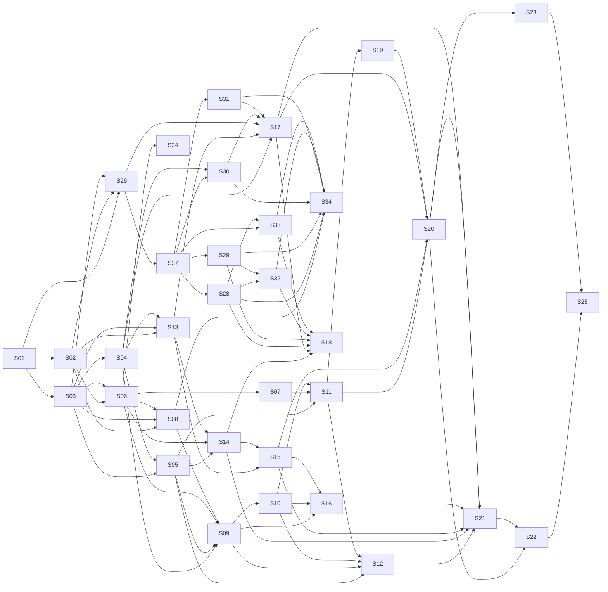

# Implementation Plan

The detailed per-slice fields (objective, files, contracts, dependencies, migration/config impact,
tasks, tests, runtime verification, security/eval, rollback, completion evidence) live in each
`docs/specs/Sxx-*.md`. This plan holds only what spans slices: order, dependencies, parallel tracks,
phase gates, status, and traceability.

## 1. Ordering principles

Following the `implementation-plan` skill and src §35.1, adapted for greenfield:

1. Skeleton, config, health, CI → persistence → frozen shared contracts.
2. Static knowledge and live context (metadata, Airflow, MCP) before any agent.
3. A thin end-to-end **manual** self-healing path (baseline parity) before automation.
4. Deterministic monitoring and incidents, then automatic RCA.
5. DQ agent suite (S26–S34), built in-repo as an independent service on its own track starting right after Phase 0,
   then platform DQ integration (S17, S18).
6. Semantic verification and resolution chain.
7. UI completion, canonical E2E, evals, hardening, release.

Integration risk is retired early: Airflow (S05) and MCP (S06/S07) come before the LLM work, and the
riskiest safety boundary (execution, S11) lands in Phase 2 so it gets the longest soak.

## 2. Slice map and status board

| ID | Slice | Phase | Owner agent | Depends on | Tags | Status |
|---|---|---|---|---|---|---|
| [S01](specs/S01-project-skeleton.md) | Project skeleton, config, logging, auth scaffold, health, CI | 0 | devops-sre | — | runtime, security-sensitive | DONE |
| [S02](specs/S02-persistence-foundation.md) | Persistence foundation, migrations, audit and activity | 0 | data-engineer | S01 | schema | DONE |
| [S03](specs/S03-domain-contracts.md) | Shared domain contracts and canonical hashing | 0 | backend-engineer | S01 | contract, security-sensitive | DONE |
| [S04](specs/S04-static-metadata-layer.md) | Static Metadata Layer (META-01..04) | 1 | backend-engineer | S03 | contract | DRAFT |
| [S05](specs/S05-airflow-integration.md) | Airflow client, context provider, operator APIs (META-09) | 1 | backend-engineer | S03, S04 | security-sensitive | DRAFT |
| [S06](specs/S06-mcp-manager-permissions.md) | MCP manager and tool-permission registry | 1 | backend-engineer | S02, S03 | security-sensitive | DRAFT |
| [S07](specs/S07-mcp-servers-postgres-mysql.md) | PostgreSQL and MySQL MCP servers | 1 | backend-engineer | S06 | security-sensitive | DRAFT |
| [S08](specs/S08-llm-agent-runtime.md) | LLM and agent runtime foundation | 2 | ai-engineer | S02, S03, S06 | ai, security-sensitive | DRAFT |
| [S09](specs/S09-diagnostic-rca.md) | Diagnostic service, read-only RCA (manual) | 2 | ai-engineer | S04, S05, S06, S08 | ai, security-sensitive, schema | DRAFT |
| [S10](specs/S10-hitl-reviews-revisions-sop.md) | HITL reviews, revisions, SOP governance | 2 | backend-engineer | S09 | ai, security-sensitive, schema, runtime | DRAFT |
| [S11](specs/S11-durable-remediation-execution.md) | Durable remediation execution and recovery wait | 2 | backend-engineer | S05, S07, S10 | ai, security-sensitive, schema, runtime | DRAFT |
| [S12](specs/S12-streamlit-console-v1.md) | Streamlit operator console v1 | 2 | frontend-engineer | S05, S09, S10, S11 | ui | DRAFT |
| [S13](specs/S13-monitoring-events.md) | MonitoringEvent persistence and ingestion (AM-01, AM-03) | 3 | backend-engineer | S02, S03, S04 | schema, security-sensitive | DRAFT |
| [S14](specs/S14-monitors-orchestrator-worker.md) | Monitors, orchestrator, worker (AM-04, 06, 07; META-05) | 3 | backend-engineer | S05, S06, S13 | runtime | DRAFT |
| [S15](specs/S15-incidents.md) | Incidents: dedup, state machine, timeline (AM-08) | 3 | backend-engineer | S13, S14 | schema, contract | DRAFT |
| [S16](specs/S16-incident-rca-auto-rca.md) | Incident RCA and auto_rca (AM-09; META-07, 08) | 3 | ai-engineer | S09, S10, S15 | ai, schema, runtime, security-sensitive | DRAFT |
| [S17](specs/S17-dq-core-custom-recon.md) | DQ platform integration: adapters, orchestrator, persistence (AM-05; META-06) | 4 | data-engineer | S04, S13, S26, S30, S31 | schema, security-sensitive | DRAFT |
| [S18](specs/S18-dq-monitor-advanced-adapters.md) | DQ monitor, remaining platform adapters, baselines | 4 | data-engineer | S14, S17, S28, S29, S32, S33 | — | DRAFT |
| [S19](specs/S19-semantic-verification-replan.md) | Semantic technical verification and replan | 5 | backend-engineer | S11 | ai, security-sensitive, schema | DRAFT |
| [S20](specs/S20-dq-verification-recovery-resolution.md) | DQ verification, recovery verification, resolution (AM-10) | 5 | backend-engineer | S11, S15, S17, S19 | schema, runtime, security-sensitive | DRAFT |
| [S21](specs/S21-streamlit-monitoring-incidents.md) | Streamlit monitoring, incident, DQ, metadata views (AM-11; META-10) | 6 | frontend-engineer | S12, S14, S15, S16, S17, S20 | ui | DRAFT |
| [S22](specs/S22-canonical-e2e-and-evals.md) | Canonical E2E and evaluation suite | 6 | qa-engineer | S20, S21 | ai, runtime | DRAFT |
| [S23](specs/S23-security-rbac-observability.md) | Security, RBAC and observability hardening | 6 | backend-engineer | S20 | security-sensitive, runtime | DRAFT |
| [S24](specs/S24-mcp-servers-s3-mongodb.md) | S3 and MongoDB MCP servers | 1–6 (parallel) | backend-engineer | S06 | security-sensitive | DRAFT |
| [S25](specs/S25-production-readiness-release.md) | Production readiness and release | 6 | release-manager | S22, S23 | runtime | DRAFT |
| [S26](specs/S26-dq-service-foundation.md) | DQ service foundation: core library, connectors, DuckDB, jobs, client | 4 (starts after P0) | data-engineer | S01, S02, S03 | runtime, security-sensitive, schema, contract | DRAFT |
| [S27](specs/S27-dq-file-manager.md) | File Manager: uploads, versions, preview, model registry, presets | 4 | data-engineer | S26 | security-sensitive, schema | DRAFT |
| [S28](specs/S28-dq-preprocessing-agent.md) | Data Preprocessing Agent | 4 | data-engineer | S27 | dq-algorithm, security-sensitive | DRAFT |
| [S29](specs/S29-dq-profiling-agent.md) | Data Profiling Agent | 4 | data-engineer | S26, S27 | dq-algorithm | DRAFT |
| [S30](specs/S30-dq-custom-dq-agent.md) | Custom DQ Agent | 4 | data-engineer | S26, S27, S04 | dq-algorithm, security-sensitive | DRAFT |
| [S31](specs/S31-dq-recon-agent.md) | Data Recon Agent | 4 | data-engineer | S26, S27 | dq-algorithm, security-sensitive | DRAFT |
| [S32](specs/S32-dq-statistical-check-agent.md) | Statistical Check Agent | 4 | data-engineer | S28, S29 | dq-algorithm | DRAFT |
| [S33](specs/S33-dq-anomaly-detection-agent.md) | Anomaly Detection Agent | 4 | data-engineer | S27, S28 | dq-algorithm, security-sensitive | DRAFT |
| [S34](specs/S34-dq-workbench-ui-gateway.md) | DQ Workbench: gateway, Streamlit pages, grounded narrator | 4 | frontend-engineer | S08, S27–S33 | ui, ai, security-sensitive | DRAFT |

Update the **Status** column whenever a spec's front-matter status changes.

## 3. Dependencies, critical path and parallel tracks

**Critical path:** S01 → S03 → S04 → S05 → S09 (after S08) → S10 → S11 → S19 → S20 → S22 → S25.
**Second near-critical path:** S03 → S26 → S27 → S30/S31 → S17 → S20. S20 needs S17, so the DQ track must start
immediately after Phase 0 or it becomes the critical path.

**Parallel tracks** (mapped to the source's team model, src §31; run in separate worktrees):

| Track | Team | Sequence |
|---|---|---|
| A Platform | TM1 | S01 → S02 → S03 → S04 → S13 → S15 |
| B Runtime/Integration | TM4 | S05 → S06 → S07 → S11 → S20; S24 anytime after S06 |
| C AI | TM3 | S08 → S09 → S10 → S16 → S19 |
| D1 DQ agent suite | TM2 | S26 → S27 → {S28, S29, S30, S31 in parallel} → S32 → S33 → S34 |
| D2 DQ platform integration | TM2 | S14 → S17 (after S30, S31) → S18 (after S32, S33) |
| E UI/QA | TM5 | S12 → S21 → S22 |
| Release | all | S23 → S25 |

With a single implementer, follow the table order in §2. S13–S15 may be interleaved after S04
while Phase 2 is under review.

## 4. Phase exit criteria (G5)

Each phase exit is demonstrated on a clean checkout, and the evidence is appended to §7.

| Phase | Slices | Exit criteria |
|---|---|---|
| **P0 Foundation** | S01–S03 | `uv sync`; `ruff`, `mypy`, unit and contract tests green locally and in CI; API boots; `migrate up` on fresh PG then `status` shows none pending; contract JSON Schemas v1 exported and **human-signed-off (contract freeze v1)**. |
| **P1 Context** | S04–S07 | With dev compose: `/metadata/health` has 0 errors; `/pipelines/customer_daily_load/context` returns `static_metadata` and a live `airflow` section (real dev Airflow, or `NOT VERIFIED` plus fake); `/mcp-status` shows postgres and mysql healthy with 0 unclassified tools; `find_duplicates` on seeded `dw.customer` returns 417. |
| **P2 Baseline parity** | S08–S12 | Via Streamlit on dev compose: failed run → RCA → review → accepted revision (new hash) → approve → job → structural and assertion verification → recovery run → review SUCCEEDED only after recovery success. `security-reviewer` pass on S06, S07, S10, S11 with no open High/Critical. Replay evals E-RCA, E-REV, E-EXE meet blocking metrics. |
| **P3 Monitoring and incidents** | S13–S16 | With **no Streamlit running**: a failure callback plus polling yields exactly 1 incident; 10 further cycles still yield 1; auto RCA reaches AWAITING_APPROVAL; audit shows 0 LLM calls from monitoring. |
| **P4 DQ suite and integration** | S26–S34, S17–S18 | (a) E-DQ-CDQ and E-DQ-RCN at 100 % exact; E-DQ-PRF/PRE blocking metrics pass; E-DQ-STAT/ANO meet thresholds. (b) The Workbench demo UC-AC10 passes. (c) The TARGET checkpoint on seeded compose data through the **real DQ service** → CRITICAL `BR-CUST-002` (417) and recon diff +417 → exactly one `DATA_QUALITY` incident. (d) `security-reviewer` pass on S26, S27, S33, S34 with no open High/Critical. |
| **P5 Verification chain** | S19–S20 | Integration suite: RESOLVED only after assertions, DQ rerun, recovery SUCCESS and final DQ; UC-AC3/AC4/AC5 negative tests pass. |
| **P6 Release** | S21–S25 | UC-AC1 canonical E2E passes in e2e compose; live evals meet release thresholds; `docs/security-review.md` has no open High/Critical; `docs/production-readiness.md` has no FAIL or NOT VERIFIED on blocking items; release checklist complete. |

## 5. Risk register

| Risk | Impact | Likelihood | Mitigation | Owner |
|---|---|---|---|---|
| DQ suite scope (7 capabilities, 9 slices) delays S17 → S20 | Slips P5/P6 | Medium | Start track D1 right after P0; prioritize S30/S31 (canonical path) before S32/S33 | data-engineer |
| Statistical false alarms on large samples | Alert fatigue, noisy incidents | Medium | Effect-size gating + BH correction (S32); non-blocking by default; seeded false-alarm evals | data-engineer |
| Unsafe code execution via uploads, expressions or models | RCE / data exposure | Low / severe | Safe-expression AST allowlist, DuckDB sandbox, no user pickles, signed artifacts, upload caps (ADR-014) | security-reviewer |
| Cross-dialect recon false mismatches | Wrong CRITICALs | Medium | Hash in DuckDB after extraction; normalization rules; E-DQ-RCN cross-dialect cases | data-engineer |
| LangChain/agent API churn | Rework in S08–S11 | Medium | Pin versions; wrap in `backend/agents/factory.py`; fake chat model in tests | ai-engineer |
| Airflow 2 vs 3 API (OQ-03) | S05 rework | Medium | Version seam in the client; contract tests per version | backend-engineer |
| Gemini structured-output reliability | Eval failures | Medium | Repair retry, schema-first prompts, replay evals | ai-engineer |
| Write-path safety defects | Data damage | Low / severe | Defence in depth (registry, toolsets, write guard, DB roles, server limits, assertions); security review at P2 | security-reviewer |
| Docker/Windows dev friction | Slower integration tests | Medium | Compose files tested on Windows; fakes for unit/contract layers | devops-sre |
| Scope size vs. team | Schedule | Medium | Phase gates allow release of P2 (manual parity) as an internal milestone | orchestrator |

## 6. Traceability: requirements → slices

| Requirement(s) | Slice(s) |
|---|---|
| FR-001–FR-005 | S04 |
| FR-010, FR-011 | S05 |
| FR-012 | S05, S08 |
| FR-013 | S05, S11 |
| FR-014 | S11, S20 |
| FR-020, FR-021, FR-022, FR-024 | S06 |
| FR-023 | S07, S24 |
| FR-030 | S09, S16 |
| FR-031, FR-034 | S09 |
| FR-032 | S09, S16 |
| FR-033 | S09, S19 |
| FR-040–FR-046 | S10 |
| FR-050–FR-054 | S11 |
| FR-055, FR-060 | S19 |
| FR-061, FR-063 | S20 |
| FR-062, FR-064 | S11, S20 |
| FR-070 | S13 |
| FR-071–FR-076 | S14 |
| FR-080–FR-082, FR-084, FR-085 | S15 |
| FR-083 | S16 |
| FR-090–FR-095 | S17 |
| FR-096 | S18 |
| FR-100, FR-101 | S12, S21 |
| FR-102 | S12 |
| FR-103 | S21 |
| FR-110 | S02 |
| FR-120–FR-123 | S26 |
| FR-130–FR-134 | S27 |
| FR-140–FR-144 | S28 |
| FR-150–FR-154 | S29 |
| FR-160–FR-164 | S30 |
| FR-170–FR-173 | S31 |
| FR-180–FR-184 | S32 |
| FR-190–FR-194 | S33 |
| FR-200, FR-201 | S34 |
| NFR-070 | S26, S28–S33 |
| NFR-071, NFR-074 | S26 |
| NFR-072 | S27, S28, S33 |
| NFR-073 | S29–S33 |
| UC-AC10 | S34 |
| FR-111 | S08 |
| FR-112 | S23 |
| NFR-001 | S01, S02, S05, S23 |
| NFR-002, NFR-003 | S01, S23 |
| NFR-004 | S06, S09, S14 |
| NFR-005 | S08, S09, S16 |
| NFR-006 | S07, S17, S24 |
| NFR-010 | S10, S11, S14, S16 |
| NFR-011 | S05, S06, S08 |
| NFR-012 | S11, S13, S15 |
| NFR-013 | S11 |
| NFR-020 | S11, S13 |
| NFR-021 | S14 |
| NFR-022, NFR-030 | S08 |
| NFR-040 | S02, S10, S11, S15 |
| NFR-041 | S10 |
| NFR-050 | S12, S21 |
| NFR-060 | S01 (enforced in every slice) |
| NFR-061 | S01, S23, S25 |
| UC-AC1 | S22 |
| UC-AC2 | S09, S14, S22 |
| UC-AC3 | S10, S11 |
| UC-AC4 | S20 |
| UC-AC5 | S19 |
| UC-AC6 | S15 |
| UC-AC7 | S14 |
| UC-AC8 | S04 |
| UC-AC9 | S16, S22 |

## 7. Phase exit evidence log

| Phase | Date | Commit | Evidence summary | Signed off by |
|---|---|---|---|---|
| — | — | — | — | — |
