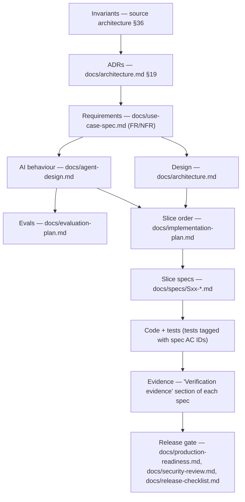
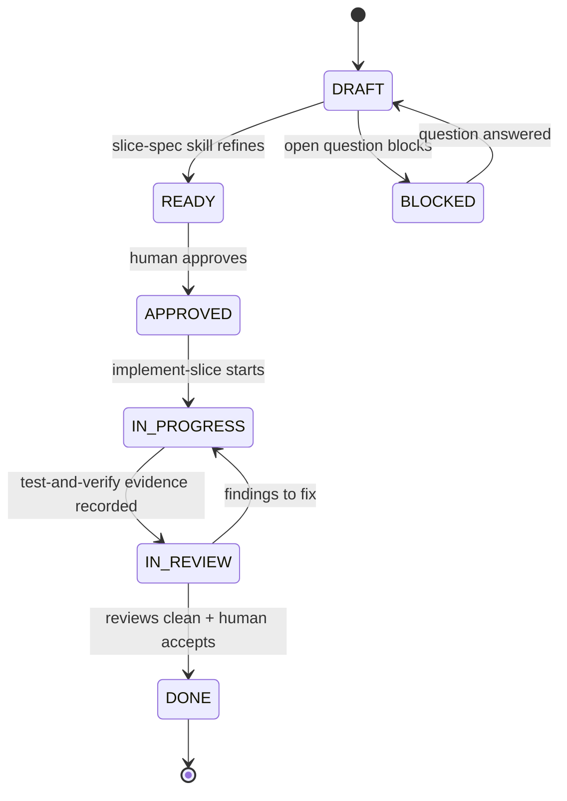

# Spec-Driven Development (SDD) Workflow

This document defines **how** the platform described in
[`self_healing_platform_architecture_coding_agent.md`](../self_healing_platform_architecture_coding_agent.md)
(the *source architecture*) is built from an empty repository, using the skills in
`.claude/skills/` and the agents in `.claude/agents/`.

The core rule: **no production code is written without an APPROVED spec, and no spec is DONE
without recorded verification evidence.**

---

## 1. Artifact hierarchy

Every artifact has one job. Lower layers must not contradict higher layers; if they do, stop and
raise the conflict (see §8).



| Artifact | Answers | Produced by (skill) | Primary agent |
|---|---|---|---|
| Source architecture (`self_healing_platform_architecture_coding_agent.md`) | Baseline intent, invariants, target design | — (input) | — |
| `docs/use-case-spec.md` | *What* must the system do (FR/NFR, acceptance) | `idea-to-spec` | `product-analyst` |
| `docs/architecture.md` | *How* it is structured; ADRs; reconciled contradictions | `architecture` | `solution-architect` |
| `docs/agent-design.md` | How each LLM agent behaves, its tools, limits, safety | `agent-design` | `agent-architect` |
| `docs/dq-agents-design.md` | Design of the DQ agent suite subsystem (DQ service) | `architecture` | `solution-architect`, `data-engineer` |
| `docs/evaluation-plan.md` | How AI behaviour is measured and gated | `agent-evaluation` | `evaluation-engineer` |
| `docs/implementation-plan.md` | Slice order, dependencies, phase gates, status board | `implementation-plan` | `orchestrator` |
| `docs/specs/Sxx-*.md` | The executable contract for one vertical slice | `slice-spec` (project skill) | slice owner agent |
| Code + tests | The implementation | `implement-slice`, `test-and-verify` | owner engineer agent, `qa-engineer` |
| Review findings | Correctness/security/eval of the slice | `security-review`, `agent-evaluation` | `code-reviewer`, `security-reviewer`, `evaluation-engineer` |
| Release docs | Is it safe to ship | `production-readiness`, `security-review`, `release` | `release-manager`, `devops-sre` |

---

## 2. Greenfield interpretation of the source architecture

The source architecture was written for an **existing** codebase. It says "inspect current code",
"preserve CURRENT behaviour", "move first, improve second". This repository starts empty, so the
following interpretation applies to every spec (recorded as ADR-001 in `docs/architecture.md`):

| Source label | Meaning in this project |
|---|---|
| **CURRENT** | A **baseline capability that must be built** (Phases 0–2) with the behaviour the source describes. |
| **CURRENT but LIMITED** / listed in source §16 "Known Gaps" | Built **directly in its target form**. Do not reproduce the gap. (Examples: async durable approval instead of synchronous `/approve`; explicit tool-permission registry instead of name heuristics; numbered migrations instead of startup DDL; Streamlit → FastAPI only, no direct Airflow calls.) |
| **TARGET / PLANNED / NOT YET INTEGRATED** | Built in Phases 3–6 per the implementation plan. |
| **FUTURE** (Jira, Confluence) | Not built. Only the connector seam (`MetadataConnector`) exists. |
| "Preserve legacy endpoint X" | Not applicable unless the endpoint is in the API catalogue adopted by `docs/architecture.md` §6. |
| "Existing DQ agents" | **Built in this repo** as the independent DQ service (`dq_agents/`, `dq_service/`; ADR-013, `docs/dq-agents-design.md`). The self-healing backend still reaches them **only through adapters** (S17/S18), so invariant 10 holds at the platform boundary. |

The **non-negotiable invariants (source §36)** and the **safety rules (source §0.1 items 9–13, 18)**
apply unchanged.

---

## 3. Lifecycle phases and gates

| Gate | Exit artifact(s) | Skill(s) | Agent(s) | Exit criteria | Human sign-off |
|---|---|---|---|---|---|
| **G0 Baseline** | Source architecture | — | — | Accepted as input | ✔ (done) |
| **G1 Requirements** | `docs/use-case-spec.md` | `idea-to-spec` | `product-analyst` | FR/NFR numbered; open questions listed with owner; acceptance criteria testable | ✔ |
| **G2 Design** | `docs/architecture.md`, `docs/agent-design.md`, `docs/evaluation-plan.md` | `architecture`, `agent-design`, `agent-evaluation` | `solution-architect`, `agent-architect`, `evaluation-engineer`, `security-reviewer` (threat-model pass) | ADRs accepted; contradictions in source reconciled; tool matrix + limits defined; eval thresholds proposed | ✔ |
| **G3 Plan** | `docs/implementation-plan.md`, all `docs/specs/Sxx` at ≥ DRAFT | `implementation-plan` | `orchestrator` | Every FR traced to ≥ 1 slice; Phase 0 specs READY | ✔ |
| **G4 Slice loop** | One `docs/specs/Sxx` → DONE (repeats) | `slice-spec`, `implement-slice`, `test-and-verify` (+ `security-review`, `agent-evaluation` when tagged) | owner agent + reviewers (§5) | §4 definition of done | ✔ per slice (APPROVED and DONE) |
| **G5 Phase exit** | Phase demo + evidence in `docs/implementation-plan.md` | `test-and-verify` | `qa-engineer`, `orchestrator` | Phase exit criteria in the plan pass on a clean checkout | ✔ per phase |
| **G6 Release** | `docs/security-review.md`, `docs/production-readiness.md`, `docs/release-checklist.md` | `security-review`, `production-readiness`, `release` | `security-reviewer`, `release-manager`, `devops-sre` | No FAIL/NOT VERIFIED on blocking items; canonical E2E passes | ✔ |

Current position: **G0–G3 approved (2026-09-30). Phase 0 (S01–S03) DONE, contract freeze v1 signed off (2026-10-01). Phase 0 exit signed off (2026-10-01; first CI run is a follow-up once a remote exists). Phase 1 in progress: S04 DONE (2026-10-01). Next: S05.**

---

## 4. The slice loop (G4)

Each vertical slice in `docs/specs/` moves through these states. The state lives in the spec's
front-matter `status:` field and is mirrored in the status board in `docs/implementation-plan.md`.



### Step-by-step

| # | Step | Skill | Agent | Output |
|---|---|---|---|---|
| 1 | **Refine** the spec against the repo *as it actually is* (dependencies' evidence, not their status labels). Make contracts exact, ACs testable, add failure/safety ACs. | `slice-spec` | slice owner (+ `agent-architect` if tag `ai`, `data-engineer` if tag `schema`) | Spec `READY` |
| 2 | **Approve** — a human reads the spec, answers questions, sets `status: APPROVED`, `approved_by`, `approved_on`. | — | human | Spec `APPROVED` |
| 3 | **Test design** — map every AC to test cases (unit/contract/integration/e2e/eval). Write failing tests first for contracts, state machines, and safety ACs. | `test-and-verify` (planning part) | `qa-engineer` (+ `evaluation-engineer` if `ai`) | Test plan in spec; failing tests |
| 4 | **Implement** the smallest complete change. | `implement-slice` | owner engineer agent (§5) | Code, migration, config, docs |
| 5 | **Verify** — run the layered checks and record the matrix in the spec. | `test-and-verify` | `qa-engineer` | "Verification evidence" filled; status `IN_REVIEW` |
| 6 | **Review** — always `code-reviewer`; plus tag-driven reviewers (§5). | `security-review` / `agent-evaluation` as tagged | reviewers | Findings (fix → back to step 4) |
| 7 | **Close** — update the spec changelog, the plan's status board, and `tools/trace.py --strict` passes; commit. Human sets `DONE`. | — | owner + human | Spec `DONE` |

### Definition of done (adapted from source §0.8)

- [ ] Spec was `APPROVED` before implementation started.
- [ ] Every AC `Sxx-ACn` has ≥ 1 test marked `@pytest.mark.spec("Sxx-ACn")`, **or** an explicit
      runtime-verification entry in the evidence table.
- [ ] No unauthorized write path introduced (diagnosis/monitoring stay read-only).
- [ ] Contracts in `backend/domain/` changed only as the spec states; schema snapshots updated deliberately.
- [ ] Schema changes delivered as a new numbered migration; applied migrations never edited.
- [ ] Idempotency/retry behaviour covered for any job, callback, or ingestion path touched.
- [ ] Structured logs carry correlation IDs; no secrets in code, logs, or fixtures.
- [ ] `ruff`, `mypy`, unit + contract tests pass; integration tests pass or are `NOT VERIFIED` with reason.
- [ ] FastAPI boots; Streamlit boots if `frontend/` touched; workers boot if `backend/jobs/` touched.
- [ ] Reviews required by tags are complete with no open High/Critical findings.
- [ ] `python tools/trace.py --strict` passes (once S01 ships it).

---

## 5. Agent routing

### Owner agent by slice type

| Slice type | Owner agent | Consulted during refine |
|---|---|---|
| Repo, CI, containers, workers' process model, deployment | `devops-sre` | `solution-architect` |
| Contracts, services, APIs, repositories, integrations | `backend-engineer` | `solution-architect` |
| Migrations, DQ persistence, data pipelines, lineage | `data-engineer` | `backend-engineer` |
| DQ service and DQ agent algorithms (S26–S33) | `data-engineer` | `evaluation-engineer` (accuracy evals), `solution-architect` (service boundary) |
| LLM factory, prompts, agents, structured output, context building | `ai-engineer` | `agent-architect` |
| Streamlit UI | `frontend-engineer` | `product-analyst` |
| E2E scenario, failure injection | `qa-engineer` | `evaluation-engineer` |
| Release gate | `release-manager` | `devops-sre`, `security-reviewer` |

### Reviewers by tag (front-matter `tags:`)

| Tag | Mandatory reviewer(s) | Skill |
|---|---|---|
| *(every slice)* | `code-reviewer` | — |
| `security-sensitive` (auth, write tools, hashing/approval, MCP, prompts with untrusted input) | `security-reviewer` | `security-review` |
| `ai` (prompts, agents, model routing, context builders) | `evaluation-engineer` | `agent-evaluation` |
| `schema` (migrations, persistence contracts) | `data-engineer` | — |
| `runtime` (workers, jobs, deployment, health) | `devops-sre` | — |
| `ui` | `frontend-engineer` (peer); optional `design:accessibility-review` | — |
| `contract` (changes to `backend/domain/` or the DQ service `/v1` API) | `solution-architect` | — |
| `dq-algorithm` (statistical/ML/rule logic in `dq_agents/`) | `evaluation-engineer` (E-DQ suites against ground truth) | `agent-evaluation` |

The `orchestrator` agent may run the whole loop for a slice; it must follow this routing and must
not report a reviewer or test as passed without inspecting the returned evidence.

---

## 6. Traceability

- **Requirements → slices:** the matrix in `docs/implementation-plan.md` §6. Every `FR-###`/`NFR-###`
  maps to ≥ 1 slice; every slice lists its `traces:` in front-matter.
- **Slices → tests:** tests carry `@pytest.mark.spec("S09-AC3")` (marker registered in
  `pyproject.toml` by S01). One test may cover several ACs.
- **Evals → agents:** eval case IDs (`E-RCA-01`, `E-INJ-03`, …) from `docs/evaluation-plan.md` are
  referenced in the spec that introduces the behaviour.
- **Tooling:** `tools/trace.py` (S01) prints the AC → test matrix and, with `--strict`, fails when a
  `DONE` spec has an AC with neither a test nor a runtime-verification entry.

---

## 7. Branching, commits, parallel work

- Initialize git in S01 (the repo is not yet a git repository; the project's Stop hook relies on
  `git status`).
- One branch per slice: `slice/S09-diagnostic-rca`. Commits start with the slice ID:
  `S09: persist analysis and enforce read-only toolset`.
- Parallel slices (see the plan's tracks) run in separate git worktrees (agent `isolation: worktree`).
- **Migration numbers are assigned at merge time**, not at spec time, to avoid collisions between
  parallel slices. Specs name the tables; the implementer picks the next free number on rebase.
- Never edit an applied migration. Create a new one.

---

## 8. Change control and conflict resolution

**Precedence when documents disagree** (highest first):

1. Invariants — source §36 and safety rules in source §0.1.
2. ADRs in `docs/architecture.md` §19 (may supersede source *details*, never invariants).
3. The APPROVED slice spec.
4. `docs/use-case-spec.md`, `docs/agent-design.md`, `docs/architecture.md` body.
5. Source architecture body text.
6. Agent inference — never sufficient alone.

**Rules**

- If a conflict is found during implementation, **stop**, record it in the spec's "Open issues",
  and ask; do not silently pick one.
- Changing an APPROVED spec's contracts or ACs → edit the spec, add a changelog line, set it back to
  `READY`, and get re-approval. Wording fixes do not need re-approval.
- A change that would be expensive to reverse (datastore, queue technology, auth model, contract
  shape used by more than one slice) requires a new ADR.
- Deferred work discovered during a slice goes into a *new or existing later* spec, never silently
  into the current slice.

---

## 9. How to drive the loop with Claude Code

Example prompts (run from the repository root):

```text
# Approve the design gates
Review docs/use-case-spec.md, docs/architecture.md and docs/agent-design.md with the
solution-architect, agent-architect and security-reviewer agents; list conflicts and open
questions only.

# Refine the next slice
/slice-spec S01

# Implement an APPROVED slice end-to-end
Use the orchestrator agent to run the SDD slice loop for S01 per docs/sdd-workflow.md §4.

# Verify and review
/test-and-verify for S01, then have code-reviewer review the diff.

# Phase exit
Run the Phase 0 exit criteria from docs/implementation-plan.md §4 on a clean checkout and record
the evidence.
```

---

## 10. Spec file conventions

- Location: `docs/specs/Sxx-short-slug.md`; template: `docs/specs/_TEMPLATE.md`.
- Front-matter keys: `id`, `title`, `status`, `phase`, `owner_agent`, `reviewers`, `depends_on`,
  `blocked_by` (open-question IDs), `traces` (FR/NFR IDs), `source_sections`, `tags`,
  `approved_by`, `approved_on`.
- AC IDs are stable once APPROVED. Removing an AC requires a changelog entry. Do not renumber.
- Specs describe *behaviour and contracts*, not step-by-step code. Implementation notes are
  guidance, not requirements; ACs are requirements.
