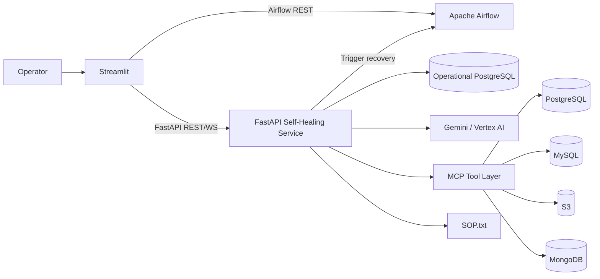
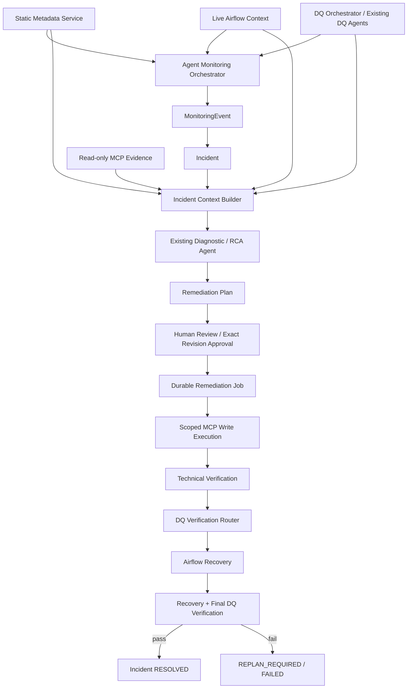
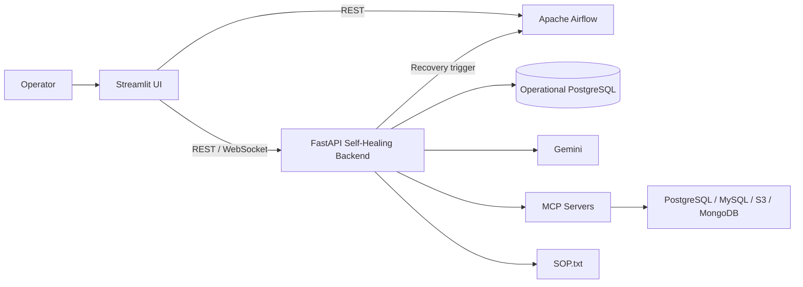
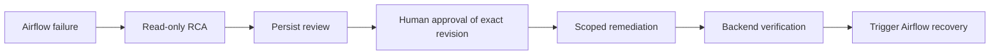
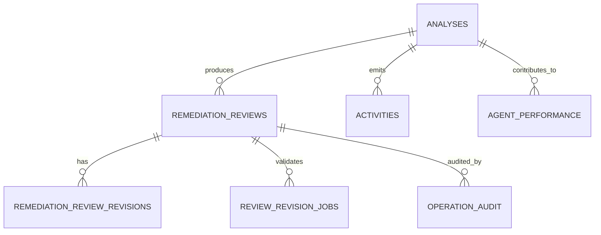
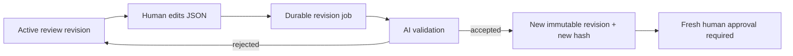
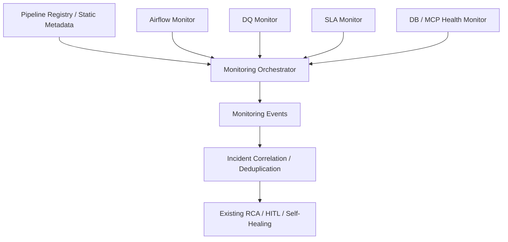
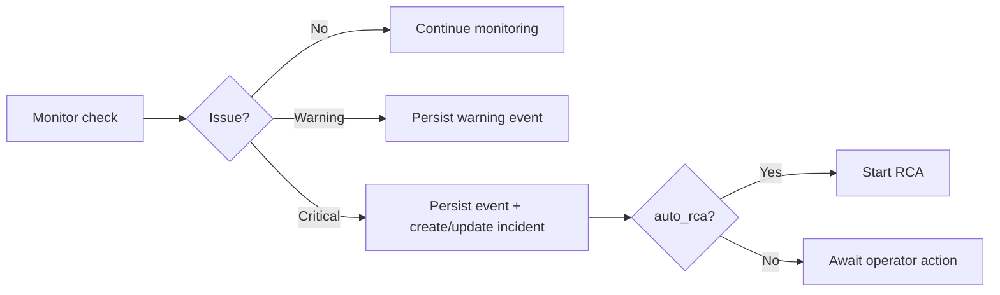
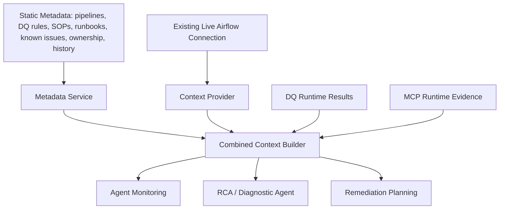
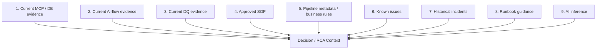

# Agentic Self-Healing Pipeline Monitor

## Coding-Agent Architecture and Implementation Specification

> **Purpose:** This Markdown file is the engineering source of truth for coding agents working on the current self-healing platform and the planned Agent Monitoring, DQ integration, Incident, verification/recovery, and static Metadata Layer extensions.
>
> **Critical:** Do not treat every architecture element in this document as already implemented. Always follow the implementation-status rules below.

## 0. Coding Agent Operating Contract

### 0.1 Read this before modifying code

1. Inspect the current repository and locate the actual implementation before editing.
2. Preserve current working behavior unless the active task/spec explicitly changes behavior.
3. Treat sections marked **CURRENT** as implemented baseline behavior to preserve.
4. Treat sections marked **TARGET**, **PLANNED**, or **NOT YET INTEGRATED** as implementation requirements, not existing code.
5. Do not invent modules, endpoints, tables, DQ-agent import paths, or external Jira/Confluence integrations when they do not exist.
6. Prefer adapters and public service contracts over direct access to another module's internals.
7. Keep FastAPI routes thin, business orchestration in services, SQL in repositories, and UI logic in Streamlit only.
8. Use numbered SQL migrations plus `schema_migrations`; do not introduce Alembic unless explicitly requested.
9. Keep the diagnostic/RCA phase read-only. Never expose write-capable MCP tools to diagnostic agents.
10. Never execute a remediation without the exact approved active-revision payload hash.
11. A successful tool call is not proof of remediation. Verify the intended state semantically.
12. Do not mark an incident `RESOLVED` until technical verification, relevant DQ verification, and Airflow recovery verification pass.
13. Airflow is already connected and is the source of **live DAG/run/task/log runtime evidence**. Do not duplicate transient Airflow state in static metadata files.
14. Jira and Confluence are **not integrated now**. The current Metadata Layer is static/version-controlled and must expose interfaces that future Jira/Confluence connectors can implement.
15. Existing DQ/data agents are external/not yet integrated into this application. Reuse them through adapters; do not recreate their algorithms.
16. Make backward-compatible changes first. Remove compatibility paths only in an explicitly approved migration task.
17. Add or update tests for every public contract, migration, service, and state transition that changes.
18. Never log secrets, credentials, raw tokens, or unredacted sensitive payloads.

### 0.2 Architecture principle

```text
Move first -> verify compatibility -> improve second.
```

The refactor and new capabilities must be implemented incrementally around the existing RCA/HITL/MCP flow rather than by replacing the working application.

## 0.3 Implementation Status Matrix

| Capability | Status | Coding-agent rule |
|---|---|---|
| Streamlit operator UI | CURRENT | Preserve behavior while modularizing. |
| Streamlit direct Airflow REST access | CURRENT | Keep during migration; target is Streamlit -> FastAPI -> Airflow. |
| FastAPI self-healing service | CURRENT | Preserve public behavior while extracting routers/services/repositories. |
| Airflow connection and runtime evidence | CURRENT | Reuse as live source of DAG/run/task/log state. |
| Diagnostic/RCA agent | CURRENT | Keep read-only. |
| Review queue / HITL | CURRENT | Preserve exact revision/hash approval semantics. |
| AI review revision jobs | CURRENT | Preserve durable behavior and history. |
| MCP PostgreSQL/MySQL/S3/MongoDB | CURRENT | Preserve current server/tool integration. |
| Tool/audit activity persistence | CURRENT | Preserve. |
| SOP.txt repository/watch/install | CURRENT | Keep operational while static metadata SOP model is introduced alongside it. |
| Approved remediation execution | CURRENT | Preserve safety boundary; later move to durable execution job. |
| Backend write-then-read verification gate | CURRENT but LIMITED | Do not call this full semantic verification. Upgrade in target phase. |
| Airflow recovery trigger | CURRENT | Current backend triggers recovery but does not fully wait/verify terminal success. |
| Agent Monitoring backend orchestrator | TARGET / NOT YET IMPLEMENTED | Build as deterministic observe/detect layer. |
| MonitoringEvent persistence | TARGET | Add normalized event contract/table/API. |
| Incident entity/dedup/state machine | TARGET | Add as first-class object. |
| Existing DQ agents integrated into platform | NOT YET INTEGRATED | Integrate via adapters and DQ Orchestrator. |
| DQ run/result persistence | TARGET | Add `dq_runs` and `dq_results`. |
| Durable remediation execution jobs | TARGET | Replace long synchronous approval execution after compatibility refactor. |
| Semantic technical verification | TARGET | Bind verification to approved intent and assertions. |
| Post-remediation DQ verification | TARGET | Re-run relevant failed rules/checks only. |
| Airflow recovery terminal verification | TARGET | Wait for terminal run outcome and final DQ gate. |
| Static Metadata Layer | TARGET / NEXT IMPLEMENTATION | YAML/JSON -> loader -> validator -> repository -> service. |
| Jira connector | FUTURE | Do not implement now. |
| Confluence connector | FUTURE | Do not implement now. |

## 0.4 System boundaries

### Current control plane



### Target control plane



## 0.5 Source-of-truth and evidence precedence

Use the following priority when evidence conflicts:

1. Current MCP/database/object-store runtime evidence.
2. Current Airflow DAG/run/task/log evidence.
3. Current deterministic DQ/reconciliation evidence.
4. Approved SOP for the verified situation.
5. Current static pipeline metadata and data/business rules.
6. Known issues.
7. Historical incidents.
8. Runbook guidance.
9. AI inference.

Static metadata and historical knowledge guide investigation; they are not proof of current runtime state.

## 0.6 Current vs target data ownership

| Information | Source of truth now/target | Do not store as static metadata |
|---|---|---|
| DAG/run/task state | Live Airflow | latest run state, failed task state, retry count |
| Task logs | Live Airflow | copied log snapshots in YAML |
| DB/object-store current state | MCP/runtime system | transient query results |
| Pipeline intent/config | Static Metadata Layer | - |
| SLA policy | Static Metadata Layer | transient SLA result |
| DQ/business rules | Static Metadata Layer | current DQ execution result |
| SOP/runbook/known issue | Static Metadata Layer | current runtime evidence |
| DQ result | DQ runtime + persistence | rule definition only |
| Incident lifecycle | Operational PostgreSQL | static YAML |
| Review/approval/audit | Operational PostgreSQL | static YAML |

## 0.7 Target module ownership boundaries

```text
backend/domain/          -> shared contracts (TM1 owner)
backend/repositories/    -> persistence/SQL (TM1)
backend/api/             -> thin REST/WebSocket routes (TM1 + feature owner)
backend/dq/              -> DQ adapters/registry/orchestrator/verification (TM2)
backend/monitoring/      -> Airflow/DQ/SLA/DB/MCP monitoring orchestration (TM2/TM4)
backend/agents/          -> agent construction/invocation (TM3)
backend/prompts/         -> prompts/policies (TM3)
backend/llm/             -> Gemini factory/callbacks/cost usage (TM3)
backend/sop/             -> current SOP repository/watch/install (TM3)
backend/metadata/        -> static metadata loader/repository/service/context builder (TM1 core)
backend/airflow/         -> live Airflow API/tools/callbacks/recovery (TM4)
backend/mcp/             -> MCP manager/tool registry/permissions (TM4)
backend/jobs/            -> durable background jobs (TM4)
frontend/                -> Streamlit UI/API client only (TM5)
migrations/              -> numbered SQL migrations (TM1)
tests/e2e/               -> cross-team acceptance scenarios (TM5 coordinator)
```

## 0.8 Definition of done for any coding-agent task

A task is not complete until all applicable items pass:

- [ ] Current implementation inspected before editing.
- [ ] Spec/status verified: CURRENT vs TARGET.
- [ ] Public contract preserved or explicitly versioned.
- [ ] No unauthorized write path introduced.
- [ ] Unit tests added/updated.
- [ ] Contract/API tests added/updated.
- [ ] Migration added for schema changes.
- [ ] Idempotency/retry behavior considered for jobs/callbacks.
- [ ] Structured logging/correlation IDs retained or added where relevant.
- [ ] FastAPI imports and starts.
- [ ] Streamlit imports and starts if frontend touched.
- [ ] No secrets added to code/logs.
- [ ] Acceptance criteria for the active spec demonstrated.

---

# Architecture and Functional Baseline

The remainder of this file preserves the complete architecture/functionality baseline from document v1.3, converted into Markdown and augmented with coding-agent-friendly diagrams and rules.


# 1. Executive Summary

The current solution is an operator-driven agentic self-healing platform for Airflow ETL failures. Streamlit provides monitoring, workflow control, RCA visualization, human review, revision editing, governance and audit views. FastAPI hosts the diagnostic and healing agents, persists analysis/review/audit state in PostgreSQL, manages MCP integrations, uses Gemini for structured reasoning, evaluates SOP applicability, gates write-capable remediation behind human approval, verifies post-write evidence, and can trigger an Airflow recovery run.

| **Important baseline:** The current runtime does not yet integrate your separate Data Preprocessing, Data Profiling, Data Recon, Custom DQ, Statistical Check or Anomaly Detection agents. Those capabilities are external to the current application and are integration targets for the next phase. |
|-------------------------------------------------------------------------------------------------------------------------------------------------------------------------------------------------------------------------------------------------------------------------------------------------------|

- Monitoring is currently primarily Airflow-oriented and is initiated/read directly from Streamlit through the Airflow REST API.

- This revision adds the target Agent Monitoring layer: a backend Monitoring Orchestrator coordinates Airflow, DQ, SLA and DB/MCP monitors, normalizes signals into MonitoringEvents, deduplicates them into Incidents, and routes critical incidents into the existing read-only RCA/HITL/self-healing flow. This layer is documented as the next implementation stage, not as already-completed runtime behavior.

- The backend diagnostic phase is deliberately read-only: Airflow read tools and read-only MCP tools are exposed to the diagnostic agent.

- A proposed write remediation is persisted as a review; approval is tied to the exact active revision through a SHA-256 payload hash.

- Human-edited remediation JSON is revalidated by an AI revision agent and, when accepted, becomes a new persisted revision that requires fresh approval.

- After approval, write-capable tools for the target system are exposed to a healing agent, which must re-read current state before writing.

- The backend considers remediation verified only when the model reports a fixed state and the audit trail shows a successful write followed by a later successful read.

- An Airflow recovery DAG run is triggered only after remediation verification; the current backend does not itself wait for that recovery run to reach a terminal success state.

# 2. Current System Architecture

The current architecture is a two-application control plane around Airflow and external data systems: a Streamlit operator console and a FastAPI self-healing service.



***Figure 1 - Current high-level architecture as implemented***

The current implemented architecture remains unchanged in Figure 1. Section 21 adds the backend Agent Monitoring layer, while Section 33 describes the static Metadata/Knowledge Layer and explains how it is combined with the already-connected live Airflow context. These target additions surround and reuse the current RCA, HITL, MCP and recovery capabilities rather than replacing them.

| **Layer**                   | **Current Component**                         | **Primary Responsibility**                                                                                            |
|-----------------------------|-----------------------------------------------|-----------------------------------------------------------------------------------------------------------------------|
| Presentation / Operator     | Streamlit                                     | Airflow monitoring, trigger/control, RCA visualization, HITL review/revision, governance and audit display.           |
| Application / Control Plane | FastAPI                                       | Agent orchestration, review state, AI revision jobs, approved remediation, audit, activity feed and recovery trigger. |
| Orchestration               | Apache Airflow REST API                       | DAG/run/task state, task logs, workflow trigger and recovery run execution.                                           |
| AI Reasoning                | Gemini 2.5 Pro through ChatGoogleGenerativeAI | Structured RCA, remediation planning, revision validation, SOP generation and execution reasoning.                    |
| Tool / Integration          | MCP servers                                   | PostgreSQL, MySQL, AWS S3 and MongoDB inspection/remediation tools.                                                   |
| Operational Persistence     | PostgreSQL                                    | Analyses, reviews, revisions, revision jobs, operation audit, activities and agent counters.                          |
| Governance Knowledge        | SOP.txt                                       | Approved SOP catalogue plus newly approved SOP blocks installed after human approval.                                 |

# 3. Current Runtime Components and Responsibilities

| **Component**                  | **Current Functionality**                                                                                                                             |
|--------------------------------|-------------------------------------------------------------------------------------------------------------------------------------------------------|
| Streamlit Runtime              | Runs the operator UI; caches Airflow DAG/run analytics; holds only UI/session state such as selected DAG, current tracked run and cached review data. |
| AirflowClient (frontend)       | Calls /api/v1 health, DAG list, DAG runs, task list/instances, trigger and pause/resume methods.                                                      |
| AgentClient (frontend)         | Calls FastAPI health, /agent, analyses, reviews, revision jobs, audit, performance, activities, logs and cost endpoints.                              |
| FastAPI app/lifespan           | Checks operational DB, initializes schema, loads/watches SOP.txt, starts/probes MCP servers, discovers MCP tools, constructs agents and exposes APIs. |
| Diagnostic agent               | Read-only RCA and remediation planning. Uses Airflow read tools plus read-only MCP tools.                                                             |
| Review revision agent          | No-tool agent validating human edits against evidence and safety policy.                                                                              |
| SOP generation agent           | No-tool agent producing a proposed reusable SOP from verified evidence and a validated remediation.                                                   |
| Healing agent                  | Post-approval execution agent with target-scoped MCP write tools plus read tools; executes only the approved plan.                                    |
| Execution replan agent         | No-tool agent intended to produce a revised proposal after execution/verification failure.                                                            |
| Operational PostgreSQL         | Durable record of analyses/reviews/revisions/jobs/audit/activities.                                                                                   |
| SOP watcher                    | Reloads SOP.txt when the file changes.                                                                                                                |
| WebSocket activity broadcaster | Pushes newly recorded activities to connected subscribers.                                                                                            |

# 4. Streamlit Frontend Implementation

The current Streamlit application is both an Airflow monitoring client and a self-healing control console. It directly calls Airflow and also calls the FastAPI agent service.

## 4.1 Runtime configuration

| **Setting**                            | **Purpose**                          | **Current Behavior**                                                |
|----------------------------------------|--------------------------------------|---------------------------------------------------------------------|
| AIRFLOW_BASE_URL / username / password | Frontend Airflow REST access         | Used by AirflowClient; direct Streamlit-to-Airflow communication.   |
| AGENT_BASE_URL                         | FastAPI service location             | Used by AgentClient.                                                |
| DAG_CACHE_TTL / ANALYTICS_CACHE_TTL    | Reduce repeated Airflow API load     | Used with st.cache_data.                                            |
| AGENT_TIMEOUT_SECONDS                  | Long diagnostic HTTP read timeout    | Clamped between 60 and 900 seconds; default 600.                    |
| REVIEW_TIMEOUT_SECONDS                 | Approval/remediation request timeout | Used because /approve currently performs remediation synchronously. |
| Revision job timeouts                  | Revision submission/status polling   | Revision processing itself is backend asynchronous.                 |

## 4.2 Session state

Streamlit session state is used only for UI continuity and cached selections/results. Durable workflow state is stored in the backend PostgreSQL database.

| **Session Key Group** | **Examples**                                       | **Purpose**                                                            |
|-----------------------|----------------------------------------------------|------------------------------------------------------------------------|
| Workflow selection    | selected_dag, show_active_only, last_triggered_run | Tracks current operator focus and manually/recovery-triggered DAG run. |
| Agent state           | agent_state_by_run                                 | Caches the latest /agent response for a workflow/run.                  |
| Review state          | review_state_by_id, revision_job_by_review         | Caches review details and active durable revision job IDs.             |
| Analytics             | failures, tab1\_\*                                 | Caches failure scan and chart source data.                             |
| Governance            | governance\_\*                                     | Caches analyses, reviews, cost/performance and sampled Airflow runs.   |

## 4.3 Data-flow Monitoring tab

- Scans active Airflow DAGs, fetches recent failed DAG runs and failed/upstream_failed tasks, and builds a failure dashboard.

- Calculates rolling seven-day, today and older failure counts.

- Classifies failures heuristically as Data Quality, Resource, Connectivity, Dependency or Runtime based on failure-message tokens.

- Builds workflow status, run timeline and six-month trend charts; a built-in fallback trend dataset is shown when live history is insufficient.

- This is not yet the future backend Monitoring Orchestrator; the logic is currently executed from the Streamlit process.

## 4.4 Agentic Self-Healing tab

23. Operator triggers or tracks an Airflow run.

24. Streamlit retrieves the current DAG run and task-instance states directly from Airflow.

25. If the run fails, Streamlit identifies the first failed/upstream_failed task.

26. The operator can start Agentic AIR, which POSTs a PipelineFailureRequest to /agent.

27. The returned analysis is displayed, including RCA, evidence/findings, SOP evaluation and recommendations.

28. If the backend requires human information, Streamlit renders questions and POSTs answers to the human-input endpoint (the client supports it; endpoint implementation is assumed elsewhere if enabled).

29. If a review_id is present, the complete HITL / revision / approval controls are shown.

30. After a recovery run is created, Streamlit can switch tracking to that run and show task states until Airflow reaches success/failure.

## 4.5 Governance tab

- Displays agent performance counters from /performance.

- Displays persisted Gemini token/cost summaries from /llm-costs.

- Displays review queue/audit summary, RCA history and recent failed Airflow runs.

- Combines backend governance data with a sampled set of live Airflow analytics.

## 4.6 Review tab

- Lists reviews by status and opens a selected review.

- Shows proposed SOP/remediation, target scope, risk, exact payload hash and review revision.

- Allows reviewer editing through JSON; changes are submitted as durable revision jobs for AI validation.

- Disables approval while a revision job is processing.

- Supports approve/reject and shows revision history plus operation audit.

# 5. FastAPI Backend Implementation

The current FastAPI application is the self-healing control plane. In the supplied code it is still largely monolithic, but it already separates diagnostic, review, revision-job, remediation and audit behavior conceptually.

## 5.1 Lifespan startup

31. Test the operational PostgreSQL connection.

32. Create/ensure current operational tables when the DB is reachable.

33. Load SOP.txt and start a filesystem watcher for SOP changes.

34. Probe each MCP server; start local Python MCP server processes when the configured endpoint is not reachable.

35. Discover MCP tools separately for each server.

36. Build the complete tool set and derive a diagnostic subset that excludes tools classified as write-capable.

37. Construct the diagnostic, review-revision, execution-replan and SOP-generation agents.

38. Store tool/client/server metadata on app.state.

39. On shutdown, stop the SOP watcher and terminate MCP processes started by this service.

| **Current implementation characteristic:** Operational table creation is currently performed by application startup through ensure_operational_schema(). The refactoring plan moves this responsibility to numbered SQL migrations, but that migration framework is not yet part of the current runtime. |
|----------------------------------------------------------------------------------------------------------------------------------------------------------------------------------------------------------------------------------------------------------------------------------------------------------|

# 6. Agent and Prompt Architecture

All agents share a strong safety policy that separates evidence gathering, planning, human authorization, execution and verification. The system-specific policies provide database/object-store guidance without hard-coding individual failure use cases.

| **Agent**              | **Tools**                                               | **Structured Output** | **Current Role**                                                                                                              |
|------------------------|---------------------------------------------------------|-----------------------|-------------------------------------------------------------------------------------------------------------------------------|
| Diagnostic Agent       | Airflow read tools + read-only MCP tools                | StructuredAnalysis    | Investigate failed run/task, gather evidence, test hypotheses, evaluate SOP and propose remediation. Never writes.            |
| Review Revision Agent  | No tools                                                | ReviewRevisionResult  | Validate human-edited approval JSON against existing evidence; reject unsafe/broadened edits.                                 |
| SOP Generation Agent   | No tools                                                | SOPProposal           | Generate a reusable SOP when no approved SOP applies and the validated remediation is sufficiently evidenced.                 |
| Healing Agent          | Target system MCP read/write tools + Airflow read tools | StructuredAnalysis    | Execute exactly the approved plan after re-reading current state; verify external state; never triggers Airflow.              |
| Execution Replan Agent | No tools                                                | ReviewRevisionResult  | Replan from runtime execution evidence after an approved remediation fails or is blocked; intended to require fresh approval. |

## 6.1 Shared evidence policy

- Evidence takes precedence over assumptions.

- Logs are treated as evidence but must be verified against external state when possible.

- Initial diagnosis is always read-only.

- State-changing remediation requires explicit human approval unless an approved policy explicitly allows otherwise.

- The execution agent must stop if runtime state contradicts the approved plan.

- Successful tool invocation alone is not defined as proof of healing.

- The agent is told to distinguish OBSERVED, VERIFIED, INFERRED, PROPOSED, EXECUTED and VERIFIED_FIXED states.

## 6.2 StructuredAnalysis model

| **Field**                                | **Function**                                                                                              |
|------------------------------------------|-----------------------------------------------------------------------------------------------------------|
| summary                                  | Workflow/run/task, root cause, impact, affected system/resource and error details.                        |
| detailed_findings                        | Evidence-backed observations with evidence status and severity.                                           |
| recommendations                          | Prioritized actions and human-approval flags.                                                             |
| prevention_measures                      | Longer-term preventive recommendations.                                                                   |
| sop_match_status / matched_sop_reference | Existing SOP applicability.                                                                               |
| proposed_sop                             | Generated SOP proposal when no approved SOP applies.                                                      |
| proposed_remediation                     | Structured remediation plan with target scope, risk, preconditions/stop conditions and verification plan. |
| analysis_confidence                      | low / medium / high confidence label.                                                                     |
| additional_investigation_needed          | Missing evidence or unresolved questions.                                                                 |
| fixes_applied / pipeline_status          | Execution result semantics used by diagnostic/healing normalization.                                      |

# 7. Airflow Integration

Airflow is accessed from both the frontend and backend in the current design.

| **Path**                      | **Current Usage**                                                                                              |
|-------------------------------|----------------------------------------------------------------------------------------------------------------|
| Streamlit → Airflow           | Health, DAG listing, DAG runs, task definitions, task instances, manual DAG trigger and optional pause/resume. |
| FastAPI Agent → Airflow       | Read DAG run, failed tasks and task logs through LangChain tools during diagnosis.                             |
| FastAPI Remediation → Airflow | Trigger a new manual recovery DAG run after remediation verification succeeds.                                 |
| Streamlit → Recovery Run      | Track the recovery run after the backend returns recovery_run_id.                                              |

| **Current boundary:** The current backend triggers recovery but does not poll the recovery DAG run to terminal success before marking the remediation review SUCCEEDED. Streamlit performs later tracking. This is a known gap targeted by the future Recovery Verification service. |
|--------------------------------------------------------------------------------------------------------------------------------------------------------------------------------------------------------------------------------------------------------------------------------------|

# 8. MCP Integration and Tool Governance

The backend manages four configured MCP integrations. Servers are probed at startup and can be started as local Python subprocesses when not reachable.

| **System** | **Default MCP Endpoint**  | **Role**                                                              |
|------------|---------------------------|-----------------------------------------------------------------------|
| PostgreSQL | http://127.0.0.1:8001/mcp | Inspect and, after approval, remediate PostgreSQL state.              |
| MySQL      | http://127.0.0.1:8002/mcp | Inspect and, after approval, remediate MySQL state.                   |
| AWS S3     | http://127.0.0.1:8003/mcp | Inspect object metadata/content and perform approved object changes.  |
| MongoDB    | http://127.0.0.1:8004/mcp | Inspect collection/index/document state and perform approved changes. |

## 8.1 Read/write separation

- Tool names are currently classified heuristically using prefixes/hints such as execute, insert, update, delete, create, alter, put, upload and related tokens.

- The diagnostic agent receives only tools not classified as write-capable.

- The healing agent is built after approval with the Airflow read tools plus all tools for the approved target system, including write tools.

- The target system must be one of postgresql, mysql, s3 or mongodb and at least one write-capable tool must be available before execution proceeds.

| **Current limitation:** Write-capability classification is currently based primarily on tool names. An explicit tool-permission registry is safer and is planned for the refactored architecture. |
|---------------------------------------------------------------------------------------------------------------------------------------------------------------------------------------------------|

# 9. SOP and Human-in-the-Loop Governance

Human approval is the core authorization boundary for write-capable remediation. The application also treats SOPs as governed remediation knowledge.

## 9.1 SOP repository

- SOP_FILE_PATH defaults to SOP.txt in the backend directory.

- Approved SOP entries are parsed from blocks with SOP-ID, TITLE, STATUS and END-SOP markers.

- A matched SOP can be resolved by explicit reference, unique reference in raw analysis, a single approved repository SOP, or a legacy single-document fallback.

- When a proposed SOP is approved as part of a review, the backend appends an APPROVED SOP block with approver, review ID, risk, target system and SHA-256 of the SOP text.

- A filesystem watcher reloads SOP content when the file changes.

## 9.2 Review payload and immutable approval hash

<table>
<colgroup>
<col style="width: 100%" />
</colgroup>
<thead>
<tr class="header">
<th>approval_payload = {<br />
"sop_match_status": ...,<br />
"matched_sop_reference": ...,<br />
"proposed_sop": ...,<br />
"proposed_remediation": ...<br />
}<br />
<br />
payload_hash = SHA256(canonical_sorted_json(approval_payload))</th>
</tr>
</thead>
<tbody>
</tbody>
</table>

- The review stores current_revision, payload_hash and approved_payload_hash.

- A human approval copies the active payload hash into approved_payload_hash.

- Before execution, the backend recalculates the current approval payload hash and refuses execution if it differs from the approved hash.

- This prevents a stale approval from authorizing a later edited remediation.

# 10. Remediation Execution and Verification



*Figure 2 — Current self-healing execution flow*

## 10.1 Approval and execution

40. Reviewer approves a PENDING review.

41. Backend persists APPROVED status and approved_payload_hash.

42. execute_approved_review re-fetches the review and checks APPROVED status.

43. The exact approval payload is re-hashed and compared with approved_payload_hash.

44. If the review contains a proposed SOP, the approved SOP is installed; otherwise the matched SOP must resolve successfully.

45. The backend creates a healing agent with the target system tool set.

46. The healing agent receives the approved plan, approved SOP and diagnostic evidence and is instructed to re-read state before any write.

47. Tool calls are audited through ToolCallbackHandler.

48. Healing structured output is normalized and combined with the backend verification gate.

49. If verified, an Airflow recovery run is triggered when retry_airflow_after_success is true.

## 10.2 Current backend verification gate

<table>
<colgroup>
<col style="width: 100%" />
</colgroup>
<thead>
<tr class="header">
<th>verification passes when BOTH are true:<br />
<br />
1. Healing structured output says:<br />
fixes_applied == true<br />
pipeline_status == "remediated"<br />
<br />
2. Operation audit shows:<br />
at least one successful write-capable MCP tool call<br />
followed later by at least one successful read-capable tool call</th>
</tr>
</thead>
<tbody>
</tbody>
</table>

| **Interpretation:** This is a useful minimum gate, but it is not yet semantic verification of the original business/data condition. A later read may not prove that the exact failed condition is fixed. The planned architecture adds explicit technical assertions and DQ verification. |
|-------------------------------------------------------------------------------------------------------------------------------------------------------------------------------------------------------------------------------------------------------------------------------------------|

# 11. Operational Persistence Model



*Figure 3 — Current operational persistence relationships*

| **Table**                    | **Current Purpose**                   | **Key Characteristics**                                                                                     |
|------------------------------|---------------------------------------|-------------------------------------------------------------------------------------------------------------|
| analyses                     | Persist RCA/healing structured output | dag_id/run_id/task_id, status, JSONB structured_analysis, response_length.                                  |
| activities                   | General activity stream               | Type + JSONB details, used by governance UI/WebSocket notifications.                                        |
| agent_performance            | Simple aggregate counters             | Single row id=1 with completed analyses, tool executions, issues detected, total activities.                |
| remediation_reviews          | HITL control record                   | Proposed action, analysis snapshot, review status, revision/hash, reviewer, execution result, recovery run. |
| remediation_review_revisions | Immutable revision history            | Edited and AI-validated payload, AI summary/notes, payload hash.                                            |
| review_revision_jobs         | Durable revision-job state            | UUID, PENDING/PROCESSING/COMPLETED/FAILED, progress stage, payload/result/error.                            |
| operation_audit              | Tool/LLM/review audit trail           | Phase, event type, tool/operation, status, input/output/details, duration.                                  |

| **Persistence note:** Current revision job records are durable, but the shown startup code does not clearly reschedule already PROCESSING/PENDING revision jobs after a backend restart. The UI contains a RECOVERED_AFTER_RESTART label, but automatic restart recovery is not evident in the supplied implementation. |
|-------------------------------------------------------------------------------------------------------------------------------------------------------------------------------------------------------------------------------------------------------------------------------------------------------------------------|

# 12. API Catalogue

| **Method** | **Path**                           | **Current Function**                                                                      |
|------------|------------------------------------|-------------------------------------------------------------------------------------------|
| GET        | /                                  | Service name/version/status.                                                              |
| GET        | /health                            | Database, MCP/agent readiness, SOP availability and HITL-write requirement.               |
| GET        | /mcp-status                        | MCP server metadata and diagnostic write tools blocked.                                   |
| POST       | /agent                             | Run read-only diagnostic agent and create analysis/review when an executable plan exists. |
| GET        | /analyses/{analysis_id}            | Fetch persisted analysis.                                                                 |
| GET        | /latest-analysis                   | Fetch latest analysis optionally filtered by workflow/run.                                |
| GET        | /analyses                          | List analyses; optionally include structured_analysis.                                    |
| GET        | /performance                       | Read aggregate agent counters.                                                            |
| GET        | /llm-costs                         | Aggregate persisted LLM token/cost audit records.                                         |
| GET        | /reviews                           | List reviews by status/workflow.                                                          |
| GET        | /reviews/{review_id}               | Fetch review.                                                                             |
| GET        | /reviews/{review_id}/revisions     | Revision history.                                                                         |
| GET        | /reviews/{review_id}/audit         | Operation/tool/LLM audit rows for review.                                                 |
| POST       | /reviews/{review_id}/revise        | Synchronous AI validation of a human edit (legacy/current direct path).                   |
| POST       | /reviews/{review_id}/revision-jobs | Queue durable AI validation job; returns 202 and job ID.                                  |
| GET        | /revision-jobs/{job_id}            | Read revision job state/result.                                                           |
| GET        | /reviews/{review_id}/revision-jobs | List revision jobs for a review.                                                          |
| POST       | /reviews/{review_id}/approve       | Approve exact active revision and synchronously execute remediation.                      |
| POST       | /reviews/{review_id}/reject        | Reject review; no remediation executes.                                                   |
| GET        | /activities                        | List recent activity records.                                                             |
| GET        | /logs                              | Read tail of backend log file.                                                            |
| WS         | /ws/activities                     | Push newly created activity records to connected clients.                                 |

# 13. Configuration and Runtime Controls

| **Configuration Group** | **Examples**                                                                           | **Function**                                                                 |
|-------------------------|----------------------------------------------------------------------------------------|------------------------------------------------------------------------------|
| Airflow                 | AIRFLOW_BASE_URL, AIRFLOW_USERNAME, AIRFLOW_PASSWORD                                   | Frontend/backend Airflow REST access.                                        |
| Operational PostgreSQL  | pgsql_database, pgsql_username, pgsql_password, pgsql_host, pgsql_port                 | Backend operational persistence.                                             |
| Gemini / Vertex         | GEMINI_MODEL, GOOGLE_PROJECT_ID, GOOGLE_CLOUD_LOCATION, GOOGLE_GENAI_USE_VERTEXAI      | Model selection and Vertex mode.                                             |
| Agent limits            | AGENT_MAX_TOOL_CALLS, AGENT_MAX_MODEL_CALLS, AGENT_RECURSION_LIMIT, output-char limits | Bound agent loops and output size.                                           |
| MCP endpoints/scripts   | POSTGRES_MCP_URL/SCRIPT, MYSQL\_\*, S3\_\*, MONGODB\_\*                                | MCP discovery/startup.                                                       |
| SOP                     | SOP_FILE_PATH, SOP_WRITE_RETRIES, SOP_WRITE_RETRY_MS                                   | SOP repository persistence/retry behavior.                                   |
| LLM cost                | GEMINI_INPUT_USD_PER_1M, GEMINI_OUTPUT_USD_PER_1M, GEMINI_PRICING_REFERENCE            | Deployment-configured cost estimation.                                       |
| HITL                    | HITL_REQUIRED_FOR_WRITES                                                               | Exposed through health; architecture is designed around approval for writes. |
| Frontend timeouts/cache | AGENT_TIMEOUT_SECONDS, review/revision timeouts, DAG/analytics TTLs                    | Operator responsiveness and request behavior.                                |

# 14. End-to-End Functional Flows

## 14.1 Failure monitoring and manual diagnosis

50. Streamlit lists active Airflow DAGs and scans recent failed DAG runs/tasks.

51. Operator selects/triggers a workflow and monitors live task state.

52. When the DAG run is failed, the Self-Healing tab exposes Start Agentic AIR.

53. Streamlit sends workflow_id, run_id, failed task_id, execution date and allow_remediation=true to /agent.

54. Backend increments issue counters and runs the diagnostic agent with read-only tools.

55. Structured analysis is normalized and persisted; if a complete executable plan exists, a PENDING review is created.

56. Streamlit displays RCA and, when present, review controls.

## 14.2 Human revision workflow



*Figure 4 — Current durable human revision workflow*

57. Reviewer edits the approval JSON (SOP/remediation portion only).

58. Streamlit POSTs /reviews/{id}/revision-jobs.

59. Backend creates a persisted PENDING job with submitted_revision and returns immediately.

60. An asyncio task claims the job and runs the no-tool Review Revision Agent.

61. If no approved SOP applies and the edit is otherwise valid, the backend may call the SOP Generation Agent to complete a proposed SOP.

62. Accepted output is persisted as revision N+1 with a new SHA-256 payload hash and approved_payload_hash cleared.

63. Fresh human approval is required before execution.

## 14.3 Approved remediation and recovery trigger

64. Approve endpoint atomically transitions PENDING to APPROVED and stores reviewer/comment + approved hash.

65. Backend executes the approved review synchronously in the same HTTP request.

66. Healing agent gets target-scoped tools and executes/validates the approved change.

67. Backend verification gate checks write/read audit evidence.

68. If verified, backend triggers a new Airflow manual self-healing recovery run with recovery_of and review_id in conf.

69. Review is stored as SUCCEEDED when remediation verification and recovery trigger creation succeed.

70. Streamlit can then track that recovery DAG run separately.

# 15. Current Safety, Governance and Audit Controls

| **Control**                    | **Implementation**                                                 | **Purpose**                                                                        |
|--------------------------------|--------------------------------------------------------------------|------------------------------------------------------------------------------------|
| Read-only diagnosis            | Diagnostic tool list excludes write-capable tools                  | Prevents the RCA agent from modifying external systems.                            |
| HITL review                    | PENDING review required before write execution                     | Human authorization boundary.                                                      |
| Exact revision hash            | SHA-256 of canonical approval payload                              | Prevents approval reuse after edits.                                               |
| Target-scoped tools            | Execution tools limited to approved target system                  | Reduces cross-system blast radius.                                                 |
| Pre-write re-read instruction  | Healing prompt requires current-state validation                   | Stops execution when runtime contradicts the plan.                                 |
| Operation audit                | Tool start/end and LLM calls persisted                             | Traceability and debugging.                                                        |
| SOP approval/install           | Proposed SOP becomes repository content only after review approval | Governed learning.                                                                 |
| Unique active review scope     | Partial unique index for PENDING/APPROVED/EXECUTING review scope   | Reduces duplicate simultaneous remediation reviews.                                |
| Per-request/review async locks | In-process lock maps                                               | Prevents duplicate concurrent analysis/review mutation within one backend process. |
| Agent/tool/model call limits   | Middleware + recursion limit                                       | Bounds runaway reasoning/tool loops.                                               |

# 16. Current Limitations and Known Gaps

| **Gap**                                        | **Current Behavior**                                                                                        | **Why It Matters / Planned Direction**                                                       |
|------------------------------------------------|-------------------------------------------------------------------------------------------------------------|----------------------------------------------------------------------------------------------|
| DQ agents not integrated                       | No current runtime connection to Preprocessing, Profiling, Recon, Custom DQ, Statistical or Anomaly agents. | Future DQ Orchestrator/adapters will integrate them as monitoring and verification evidence. |
| Monitoring is frontend-heavy                   | Streamlit directly scans Airflow failures and computes monitoring analytics.                                | Backend Monitoring Orchestrator should own continuous monitoring/event persistence.          |
| No first-class Incident entity                 | Current durable objects start at analysis/review.                                                           | A first-class incident will correlate Airflow/DQ/SLA signals and own lifecycle state.        |
| Approval execution is synchronous              | POST /approve can spend minutes in Gemini/MCP/verification/recovery trigger.                                | Future durable remediation jobs should return 202 and execute independently.                 |
| Verification is structural, not fully semantic | Backend checks successful write then later successful read + model self-report.                             | Future VerificationService will assert exact postconditions and rerun DQ/reconciliation.     |
| Recovery not terminally verified by backend    | Backend triggers recovery and stores recovery run ID/state; UI later observes the run.                      | Future RecoveryService should await terminal success + final DQ before RESOLVED.             |
| Tool write classification heuristic            | Write/read is inferred from tool names.                                                                     | Explicit tool metadata/permissions should replace name heuristics.                           |
| App startup owns DB DDL                        | ensure_operational_schema creates tables.                                                                   | Numbered SQL migrations should own schema evolution.                                         |
| Revision job restart recovery unclear          | Job rows persist, but startup rescheduling is not visible in provided code.                                 | Worker/job recovery logic should reclaim interrupted jobs.                                   |
| CORS can default broadly                       | CORS_ALLOW_ORIGINS defaults to \* in code.                                                                  | Production should restrict allowed origins and add authentication/RBAC.                      |
| Credentials have development defaults          | Airflow and DB settings include code defaults suitable only for development.                                | Production should require secret-managed values and remove credential defaults.              |

# 17. Integration Points for the Existing DQ Agents

| **Not current runtime:** The following is an integration map only. It identifies where your already-developed DQ/data agents connect to the current architecture without implying that they are already wired into this implementation. |
|-----------------------------------------------------------------------------------------------------------------------------------------------------------------------------------------------------------------------------------------|

| **Existing Agent** | **Best Integration Point**                           | **Role in Future Platform**                                                     |
|--------------------|------------------------------------------------------|---------------------------------------------------------------------------------|
| Data Preprocessing | Before selected profiling/statistical/anomaly checks | Prepare/clean/normalize data samples when a downstream check requires it.       |
| Data Profiling     | DQ Orchestrator source/target checkpoint             | Baseline distributions, categorical/numerical statistics and metadata evidence. |
| Custom DQ          | Primary deterministic DQ checkpoint                  | Incompleteness, invalidity, inconsistency and business validation.              |
| Data Recon         | Post-load reconciliation checkpoint                  | Source-target counts, alignment and consistency verification.                   |
| Statistical Check  | Triggered/scheduled advanced DQ checkpoint           | MAD, outliers, p-values, skewness/kurtosis, PCA/KNN/factor analysis.            |
| Anomaly Detection  | Triggered or scheduled ML monitoring                 | Isolation Forest and anomaly scoring for complex distribution/pattern shifts.   |

- Adapters should normalize all existing agent outputs into one DQAgentResult contract.

- A DQ Orchestrator should choose which agents run at SOURCE, TARGET or RECONCILIATION checkpoints.

- Critical DQ results should become MonitoringEvents and eventually create/update a first-class Incident.

- RCA should consume DQ evidence; the LLM should interpret numeric results rather than recomputing them.

- Post-remediation verification should rerun only the relevant DQ/reconciliation rules before Airflow recovery.

# 18. Deployment / Startup Lifecycle

71. Start or make reachable the operational PostgreSQL database.

72. Start FastAPI. During lifespan startup it validates DB connectivity, ensures schema, loads SOP, probes/starts MCP servers, discovers tools and constructs agents.

73. Start Streamlit with AIRFLOW_BASE_URL and AGENT_BASE_URL configured.

74. Streamlit calls Airflow directly for DAG/run monitoring and calls FastAPI for self-healing/governance operations.

75. Optional MCP server subprocesses started by FastAPI remain children of the backend process and are terminated during lifespan shutdown.

| **Operational topology:** The current design assumes the Streamlit process can reach both Airflow and the FastAPI backend, while the FastAPI backend can reach Airflow, the operational PostgreSQL database, Gemini/Vertex, the SOP filesystem and each MCP endpoint. |
|-----------------------------------------------------------------------------------------------------------------------------------------------------------------------------------------------------------------------------------------------------------------------|

# 19. Implementation Inventory and Engineering Notes

| **Area**              | **Important Functions / Classes in Current Code**                                                                                      |
|-----------------------|----------------------------------------------------------------------------------------------------------------------------------------|
| Frontend Airflow      | AirflowClient, cached_all_dags, cached_runs_for_dags, get_dag_task_order, get_live_task_status, fetch_all_active_failures.             |
| Frontend Agent API    | AgentClient and methods for analyses, reviews, revisions, approval/rejection, performance, costs, activities and logs.                 |
| Frontend HITL         | render_review_card, render_revision_editor, render_hitl_controls, render_review_audit, render_revision_history.                        |
| Domain models         | PipelineFailureRequest, StructuredAnalysis, RemediationPlan, SOPProposal, ReviewRevisionResult and supporting models.                  |
| Persistence           | ensure_operational_schema, save_analysis, create/fetch/list review, revision/job functions, persist_activity, persist_operation_audit. |
| SOP                   | load_sop_file, list_approved_sop_entries, resolve_matched_sop, install_approved_sop, SOPFileHandler.                                   |
| Airflow backend tools | get_workflow_run_details, get_failed_tasks_in_run, get_task_logs, trigger_airflow_recovery_run.                                        |
| MCP                   | probe_server_health, start_and_check_mcp_servers, load_mcp_tools_isolated, is_write_capable_tool.                                      |
| LLM/agents            | build_llm, build_agent, ToolCallbackHandler, LLMUsageAuditHandler, prompt policies.                                                    |
| Revision jobs         | create/claim/update/fetch/list job, run_review_revision_job, schedule_review_revision_job.                                             |
| Remediation           | get_approved_execution_tools, execute_approved_review, backend_verification_gate.                                                      |

| **Recommended refactoring rule:** Move first, improve second. Extract current behavior into modules and preserve API/database compatibility before adding DQ orchestration, first-class incidents, durable remediation jobs and semantic verification. |
|--------------------------------------------------------------------------------------------------------------------------------------------------------------------------------------------------------------------------------------------------------|

# 20. Glossary

| **Term**              | **Meaning in this system**                                                                                |
|-----------------------|-----------------------------------------------------------------------------------------------------------|
| AIR                   | Agentic investigation / self-healing flow initiated from the Streamlit Self-Healing tab.                  |
| RCA                   | Root Cause Analysis produced by the read-only diagnostic agent.                                           |
| HITL                  | Human-in-the-Loop authorization and revision workflow before write-capable remediation.                   |
| MCP                   | Tool protocol used to expose PostgreSQL, MySQL, S3 and MongoDB capabilities to agents.                    |
| SOP                   | Approved remediation procedure stored in SOP.txt; can be matched or newly proposed and later approved.    |
| Approval payload hash | SHA-256 over the canonical SOP/remediation payload; binds approval to one exact revision.                 |
| Revision job          | Persisted asynchronous AI validation job for human-edited remediation JSON.                               |
| Operation audit       | Persisted record of tool and LLM operations associated with analysis/review phases.                       |
| Recovery run          | New Airflow DAG run triggered after backend remediation verification.                                     |
| DQ                    | Data Quality. Your DQ agents exist separately today and are not yet integrated into this current runtime. |

# 21. Agent Monitoring Architecture and Implementation

**Important status distinction:** the existing application already performs Airflow-oriented monitoring from Streamlit and can start RCA manually for failed runs. The Agent Monitoring layer described below is the architecture to add to the backend so monitoring becomes continuous, persistent, event-driven/polled, and directly connected to incident management. The independent DQ agents are still not integrated into the current runtime; the DQ Monitor is therefore shown as an integration point.

| **Capability**                                | **Current Runtime**                                             | **Agent Monitoring Extension**                                                           |
|-----------------------------------------------|-----------------------------------------------------------------|------------------------------------------------------------------------------------------|
| Airflow health / DAG / run / task observation | Yes — Streamlit calls Airflow REST directly                     | Move/duplicate into backend Airflow Monitor for continuous monitoring                    |
| Failure dashboard                             | Yes — computed in Streamlit                                     | Persist normalized MonitoringEvents and expose backend health APIs                       |
| Data Quality monitoring                       | No integrated DQ runtime                                        | DQ Monitor calls DQ Orchestrator/adapters for existing DQ agents                         |
| SLA monitoring                                | Not first-class                                                 | SLAMonitor detects missed schedules / late completion / excessive runtime                |
| Database / MCP health monitoring              | Health visible at startup/service status                        | Continuous DB/MCPHealthMonitor emits operational events                                  |
| Incident object                               | No first-class incident entity                                  | IncidentService correlates/deduplicates events and owns lifecycle                        |
| Automatic RCA trigger                         | Manual Start Agentic AIR                                        | Critical incident may automatically invoke existing DiagnosticService when auto_rca=true |
| Post-remediation DQ verification              | No integrated DQ rerun                                          | VerificationRouter reruns only relevant DQ/reconciliation checks                         |
| Recovery terminal verification                | Streamlit can track recovery run; backend trigger does not wait | RecoveryService waits for terminal success and final DQ before RESOLVED                  |



*Figure 5 — Extended architecture with the added Agent Monitoring layer*

## 21.1 Objectives of the Agent Monitoring Layer

- Move operational detection out of the Streamlit process so failures can be detected even when no user has the UI open.

- Normalize heterogeneous signals from Airflow, DQ, SLA and infrastructure into one MonitoringEvent contract.

- Persist monitoring evidence so RCA and governance use durable facts rather than transient UI state.

- Correlate repeated signals into one first-class Incident instead of generating alert storms.

- Route critical incidents into the existing read-only diagnostic/RCA agent without bypassing current HITL write authorization.

- Use the existing DQ agents for detection and post-remediation verification through adapters and a DQ Orchestrator rather than rebuilding their algorithms.

- Separate Observe/Detect from Diagnose/Plan/Execute so monitoring itself never performs writes.

## 21.2 Logical Component Model

| **Component**                       | **Responsibility**                                                                                                                                                                                                                      |
|-------------------------------------|-----------------------------------------------------------------------------------------------------------------------------------------------------------------------------------------------------------------------------------------|
| Monitoring Worker                   | Runs scheduled monitoring cycles and accepts event-driven signals. It should live outside Streamlit. A lightweight separate Python worker is sufficient for the first implementation; a queue/worker framework can be introduced later. |
| Monitoring Orchestrator             | Loads PipelineDefinition, runs enabled monitors, aggregates health, persists events, and asks IncidentService to create/update incidents. It never executes remediation.                                                                |
| Airflow Monitor                     | Reads DAG run/task states, failed/upstream_failed tasks, retry counts, runtime duration, stuck states and schedule timing through the backend Airflow client.                                                                           |
| DQ Monitor                          | Calls DQService/DQOrchestrator at configured checkpoints. It converts PASS/WARNING/CRITICAL DQ results into monitoring signals. Existing DQ algorithms remain in their current applications and are called through adapters.            |
| SLA Monitor                         | Compares expected schedule/completion/runtime configuration to Airflow execution state and emits deterministic SLA warnings/critical events.                                                                                            |
| Database / MCP Health Monitor       | Checks operational DB connectivity plus configured MCP server reachability/health and creates availability signals.                                                                                                                     |
| Monitoring Event Repository         | Persists normalized evidence: pipeline, run, task, source, type, severity, expected, actual and evidence JSON.                                                                                                                          |
| Incident Service                    | Generates a stable fingerprint, deduplicates repeated events, correlates evidence and moves incidents through DETECTED → INVESTIGATING → ... → RESOLVED.                                                                                |
| DiagnosticService integration       | Receives incident context and invokes the existing read-only diagnostic agent. No new write privileges are introduced.                                                                                                                  |
| Verification / Recovery integration | After an approved remediation, technical verification and relevant DQ checks must pass before recovery; recovery must reach terminal success and final DQ pass before the incident is resolved.                                         |

## 21.3 Core Monitoring Contracts

The monitoring layer should use explicit Pydantic contracts. These become shared interfaces between the platform, DQ, AI, Airflow integration and Streamlit teams.

> class MonitoringEvent(BaseModel):  
> event_id: str \| None = None  
> pipeline_id: str  
> dag_id: str \| None = None  
> run_id: str \| None = None  
> task_id: str \| None = None  
> source: Literal\["AIRFLOW", "DQ", "SLA", "DATABASE", "MCP"\]  
> event_type: str  
> severity: Literal\["INFO", "WARNING", "CRITICAL"\]  
> expected: str \| None = None  
> actual: str \| None = None  
> evidence: dict\[str, Any\] = Field(default_factory=dict)  
> detected_at: datetime
>
> class PipelineHealthResult(BaseModel):  
> pipeline_id: str  
> checked_at: datetime  
> overall_status: Literal\["HEALTHY", "WARNING", "CRITICAL"\]  
> events: list\[MonitoringEvent\]  
> monitor_status: dict\[str, str\]
>
> class IncidentStatus(str, Enum):  
> DETECTED = "DETECTED"  
> INVESTIGATING = "INVESTIGATING"  
> RCA_COMPLETED = "RCA_COMPLETED"  
> AWAITING_APPROVAL = "AWAITING_APPROVAL"  
> APPROVED = "APPROVED"  
> EXECUTING = "EXECUTING"  
> VERIFYING = "VERIFYING"  
> RECOVERY_RUNNING = "RECOVERY_RUNNING"  
> REPLAN_REQUIRED = "REPLAN_REQUIRED"  
> RESOLVED = "RESOLVED"  
> FAILED = "FAILED"  
> REJECTED = "REJECTED"

## 21.4 Monitoring Execution Flow



*Figure 6 — Continuous monitoring, incident routing and self-healing integration flow*

76. An Airflow callback, scheduled worker or manual API check starts a monitoring cycle.

77. MonitoringOrchestrator loads pipeline configuration and invokes enabled monitors.

78. Each monitor returns deterministic MonitoringEvents with evidence. The orchestrator does not ask Gemini whether a task failed or whether a numeric threshold was exceeded.

79. All material WARNING/CRITICAL events are persisted. CRITICAL events (and configured warning classes) are passed to IncidentService.

80. IncidentService creates a new incident or updates an existing open incident using a stable fingerprint.

81. If the pipeline is configured with auto_rca=true, the incident may invoke the existing DiagnosticService automatically; otherwise it waits for an operator action.

82. The existing RCA → SOP → review → revision → approval → execution workflow remains the authorization path.

83. After execution, technical checks and relevant DQ checks must pass. Failed verification moves the incident to REPLAN_REQUIRED rather than RESOLVED.

84. Airflow recovery is triggered only after verification, and the incident reaches RESOLVED only after the recovery run reaches SUCCESS and the final quality gate passes.

## 21.5 Initial Detection Rules and Severity Policy

Thresholds are pipeline/data-contract configuration, not universal constants. The table below defines suitable initial behavior for the monitoring framework; business-specific DQ thresholds should remain configurable.

| **Monitor** | **Condition**                               | **Initial Severity**           | **Evidence Required**                                      |
|-------------|---------------------------------------------|--------------------------------|------------------------------------------------------------|
| Airflow     | DAG run state = failed                      | CRITICAL                       | dag_id, run_id, execution/logical date, run state          |
| Airflow     | Task state = failed / upstream_failed       | CRITICAL                       | task_id, try_number, task state, timestamps, log reference |
| Airflow     | Running beyond configured maximum duration  | WARNING or CRITICAL            | start time, current time, configured duration              |
| Airflow     | Queued/scheduled within normal window       | INFO/HEALTHY                   | state and timing context; queued alone is not failure      |
| DQ          | Blocking DQ rule = CRITICAL                 | CRITICAL                       | dq_run_id, rule_id, expected, actual, failed rows/evidence |
| DQ          | Non-blocking statistical/anomaly warning    | WARNING                        | score/statistic, baseline and configured threshold         |
| SLA         | Expected completion time exceeded           | CRITICAL or configured WARNING | expected completion, current status/time                   |
| Database    | Connectivity check fails                    | CRITICAL                       | system identifier, exception category, timestamp           |
| MCP         | Required MCP endpoint unhealthy/unreachable | CRITICAL                       | server, URL alias/port, health probe result                |

## 21.6 Incident Correlation and Deduplication

Repeated polling must not create a new incident every cycle. IncidentService should compute a stable fingerprint from the operational scope and issue class.

> incident_key = sha256(  
> f"{pipeline_id}\|{run_id or time_bucket}\|{component}\|{event_type}\|{rule_id or metric}"  
> ).hexdigest()

- If an open incident with the same key exists, append/link the new MonitoringEvent and update last_seen_at rather than creating a duplicate.

- A different Airflow run, DQ rule, target resource or materially different issue category may generate a new incident.

- Incident evidence should contain references to monitoring_event IDs and DQ result IDs, not only copied text.

- Incident transitions should be validated by a state machine so, for example, RESOLVED cannot be entered directly from DETECTED.

## 21.7 Recommended Monitoring and Incident APIs

| **Method** | **Path**                                   | **Purpose**                                                                           |
|------------|--------------------------------------------|---------------------------------------------------------------------------------------|
| POST       | /monitoring/events                         | Accept event-driven Airflow/DQ/operational signals and persist them.                  |
| POST       | /monitoring/run                            | Run monitoring for all enabled pipelines (administrative/manual trigger).             |
| POST       | /monitoring/pipelines/{pipeline_id}/check  | Run all enabled monitors for one pipeline.                                            |
| GET        | /monitoring/health                         | Return aggregate fleet health and counts by status/source.                            |
| GET        | /monitoring/events                         | Query persisted events by pipeline/run/source/severity/time.                          |
| GET        | /monitoring/pipelines/{pipeline_id}/health | Return latest health snapshot/events for one pipeline.                                |
| GET        | /incidents                                 | List/filter incidents by status/severity/category/pipeline.                           |
| GET        | /incidents/{incident_id}                   | Return incident detail and linked evidence.                                           |
| GET        | /incidents/{incident_id}/timeline          | Return lifecycle, events, RCA, review, execution, verification and recovery timeline. |
| POST       | /incidents/{incident_id}/analyze           | Invoke the existing read-only DiagnosticService using incident context.               |

## 21.8 Persistence Additions

The existing operational tables remain intact. Agent Monitoring adds durable monitoring/incident state around them.

| **Table**            | **Key Purpose**                                                       | **Important Fields**                                                                                                    |
|----------------------|-----------------------------------------------------------------------|-------------------------------------------------------------------------------------------------------------------------|
| pipelines            | Static pipeline metadata and monitoring/DQ/self-healing configuration | pipeline_id, dag_id, source/target metadata, sla_config, dq_config, monitoring_enabled, auto_rca                        |
| monitoring_events    | Immutable/append-oriented normalized observations                     | pipeline_id, dag_id, run_id, task_id, source, event_type, severity, expected, actual, evidence, detected_at             |
| incidents            | Correlated operational issue and lifecycle                            | incident_key, pipeline_id, category, severity, status, current_analysis_id, current_review_id, detected_at, resolved_at |
| incident_events      | Many-to-many/history link between incident and monitoring signals     | incident_id, monitoring_event_id, relation_type, attached_at                                                            |
| dq_runs / dq_results | Persist execution/output of existing DQ agents once integrated        | pipeline/run/checkpoint/status; rule/agent/expected/actual/evidence                                                     |
| remediation_jobs     | Future durable remediation execution state                            | review_id, status, stage, result, error, timestamps                                                                     |
| recovery_runs        | Recovery Airflow run and final verification state                     | incident_id, review_id, original_run_id, recovery_run_id, status, final_dq_status                                       |

## 21.9 Event-Driven and Scheduled Monitoring

- Event-driven path: Airflow failure callbacks POST a lightweight MonitoringEvent immediately. The callback must not run Gemini, MCP RCA or remediation synchronously.

- Scheduled path: a separate monitoring worker checks enabled pipelines at a configured interval to detect stuck runs, missed schedules, SLA breaches, DB outages, freshness problems and conditions that do not naturally emit callbacks.

- The initial worker can be a separate Python process using asyncio. Durable queue technology such as Celery, Dramatiq, RQ or Arq can be introduced when concurrency/retry requirements justify it.

- The worker should use idempotency keys/fingerprints so retries do not duplicate events/incidents.

## 21.10 Monitor Interfaces and Orchestrator Pseudocode

> class PipelineMonitor(Protocol):  
> async def check(self, pipeline: PipelineDefinition) -\> list\[MonitoringEvent\]:  
> ...
>
> class MonitoringOrchestrator:  
> async def check_pipeline(self, pipeline_id: str) -\> PipelineHealthResult:  
> pipeline = await pipeline_repository.get(pipeline_id)  
> events: list\[MonitoringEvent\] = \[\]  
>   
> for monitor in self.enabled_monitors(pipeline):  
> events.extend(await monitor.check(pipeline))  
>   
> await monitoring_repository.save_many(events)  
>   
> for event in events:  
> if event.severity == "CRITICAL":  
> incident = await incident_service.create_or_update(event)  
> if pipeline.auto_rca:  
> await diagnostic_service.analyze_incident(incident.id)  
>   
> return aggregate_pipeline_health(pipeline_id, events)

The real implementation should normally enqueue automatic RCA instead of holding the monitoring loop open while the agent investigates.

## 21.11 Streamlit Integration

Migration should be incremental so the current UI remains usable throughout development.

| **Phase**  | **Streamlit → Airflow**                                                     | **Streamlit → FastAPI**                | **Behavior**                                                     |
|------------|-----------------------------------------------------------------------------|----------------------------------------|------------------------------------------------------------------|
| Current    | Direct REST                                                                 | RCA/reviews/governance                 | Current application as implemented.                              |
| Transition | Direct REST retained for compatibility                                      | New monitoring/incidents/DQ APIs added | Compare backend monitoring output against current UI scans.      |
| Target     | No direct operational dependency except optional fallback/admin diagnostics | All monitoring/control through FastAPI | Streamlit becomes presentation/HITL; backend is source of truth. |

- Dashboard: Healthy / Warning / Critical pipelines, open incidents, DQ failures, SLA breaches, pending reviews, self-healed today.

- Pipeline Health: Airflow, DQ, SLA, DB/MCP and overall status with latest events.

- Incident page: Overview, Monitoring, DQ Evidence, Airflow, RCA, Remediation, Review, Execution, Verification, Recovery and Audit tabs.

- Existing HITL/revision/audit components should be reused, not rewritten.

## 21.12 Integration with the Existing DQ Agents

**Current status:** the DQ agents described by the project are already developed separately but are not yet wired into this Streamlit/FastAPI application.

| **Existing Agent** | **Monitoring Role**                                                         | **Typical Trigger**                                 |
|--------------------|-----------------------------------------------------------------------------|-----------------------------------------------------|
| Data Preprocessing | Prepare data/sample when an advanced agent requires cleaning/transformation | On demand; not every monitoring cycle               |
| Data Profiling     | Baseline counts, types, categorical/numerical statistics and distributions  | Pipeline run or scheduled baseline                  |
| Custom DQ          | Deterministic incompleteness/inaccuracy/inconsistency/invalidity checks     | SOURCE/TARGET every relevant run                    |
| Data Recon         | Source-target consistency and reconciliation                                | After target load / verification                    |
| Statistical Check  | MAD/outlier/p-value/skew/kurtosis/PCA/KNN/factor checks                     | On profile change or configured advanced monitoring |
| Anomaly Detection  | ML-based anomaly scoring/pattern detection                                  | Triggered/scheduled; usually not every minute       |

- Create one adapter per existing agent; adapters convert native results into DQAgentResult and do not duplicate algorithms.

- A DQAgentRegistry maps stable logical names to adapters.

- A DQOrchestrator selects agents by pipeline/checkpoint profile and aggregates results.

- DQMonitor consumes the orchestrated result and emits MonitoringEvents; the RCA agent interprets evidence but does not recompute DQ metrics.

- After remediation, VerificationRouter reruns only the relevant DQ/reconciliation rules named by the remediation plan.

## 21.13 Integration with the Existing RCA / HITL / Remediation Lifecycle

| **Stage**   | **Existing Capability Reused**                                        | **Agent Monitoring Addition**                                        |
|-------------|-----------------------------------------------------------------------|----------------------------------------------------------------------|
| Detect      | Streamlit failed-run scan                                             | Backend monitors + normalized events + incidents                     |
| Investigate | Read-only Diagnostic Agent with Airflow/MCP tools                     | Incident context supplies monitoring/DQ evidence automatically       |
| Plan        | StructuredAnalysis, SOP evaluation, proposed remediation              | Plan also identifies expected verification/DQ rules                  |
| Authorize   | Persisted review, revisions, exact SHA-256 approval hash              | No change — remains the authorization boundary                       |
| Execute     | Healing Agent with target-scoped tools                                | Prefer durable remediation job rather than long approve HTTP request |
| Verify      | Current write+later-read gate + model fixed state                     | Add semantic assertions + DQ/recon verification                      |
| Recover     | Trigger Airflow recovery run                                          | Wait for terminal SUCCESS and final DQ gate                          |
| Resolve     | Review may currently become SUCCEEDED after recovery trigger creation | Incident becomes RESOLVED only after recovery + final verification   |

## 21.14 Recommended Implementation Structure

> backend/  
> monitoring/  
> orchestrator.py  
> airflow_monitor.py  
> dq_monitor.py  
> sla_monitor.py  
> database_monitor.py  
> mcp_monitor.py  
> services/  
> monitoring_service.py  
> incident_service.py  
> diagnostic_service.py  
> verification_service.py  
> recovery_service.py  
> repositories/  
> pipeline_repository.py  
> monitoring_repository.py  
> incident_repository.py  
> dq_repository.py  
> dq/  
> contracts.py  
> registry.py  
> orchestrator.py  
> verification_router.py  
> adapters/  
> jobs/  
> monitoring_worker.py  
> remediation_jobs.py  
> recovery_worker.py

## 21.15 Agent Monitoring Implementation Plan

| **Spec** | **Implementation**                                                                               | **Primary Owner**           | **Acceptance Gate**                                                  |
|----------|--------------------------------------------------------------------------------------------------|-----------------------------|----------------------------------------------------------------------|
| AM-01    | Define PipelineDefinition, MonitoringEvent and PipelineHealthResult contracts.                   | Platform + Monitoring       | Contracts versioned and tested.                                      |
| AM-02    | Create pipeline registry and monitoring configuration persistence.                               | Platform                    | Pipeline CRUD/config works without hardcoded Python.                 |
| AM-03    | Create monitoring_events repository/API.                                                         | Platform                    | Events persist/query with evidence.                                  |
| AM-04    | Implement AirflowMonitor using backend Airflow client.                                           | Airflow/Integration         | Failed/stuck/missed conditions produce deterministic events.         |
| AM-05    | Integrate existing DQ agents through adapters, registry and DQOrchestrator; implement DQMonitor. | DQ/Monitoring               | Custom DQ + Recon first; critical results create events.             |
| AM-06    | Implement SLA, DB and MCP monitors.                                                              | Monitoring + Integration    | Configured breaches/outages detected.                                |
| AM-07    | Implement MonitoringOrchestrator and worker (event + polling).                                   | Monitoring                  | Pipeline health aggregation and persisted events work without UI.    |
| AM-08    | Create Incident entity, correlation/dedup and timeline.                                          | Platform                    | Repeated polling creates one open incident.                          |
| AM-09    | Route incident to existing DiagnosticService; add auto_rca configuration.                        | AI + Platform               | Manual and automatic incident RCA use the same service.              |
| AM-10    | Add semantic/DQ verification, recovery terminal verification and final incident resolution.      | DQ + Integration + Platform | No RESOLVED until technical/DQ/recovery checks pass.                 |
| AM-11    | Move Streamlit monitoring views to backend monitoring/incident APIs.                             | Frontend                    | Backend becomes source of truth while existing HITL UX is preserved. |

## 21.16 End-to-End Acceptance Scenario

The first cross-team acceptance case should use a duplicate-target-data incident because it exercises DQ, monitoring, incident correlation, RCA, HITL, execution and verification.

85. MySQL sales.customer contains 100,000 clean rows; PostgreSQL dw.customer contains 100,417 rows with 417 duplicate customer_id values.

86. Target Custom DQ returns CRITICAL for customer_id uniqueness and Data Recon identifies a +417 row mismatch.

87. DQMonitor persists a CRITICAL MonitoringEvent; IncidentService creates exactly one DATA_QUALITY incident.

88. DiagnosticService receives incident + DQ + Airflow evidence, confirms the root cause using read-only tools and creates the existing governed remediation review.

89. Reviewer approves the exact remediation revision/hash. The healing agent executes only the approved scoped action.

90. Technical verification passes; Custom DQ rerun shows duplicate_count=0; Recon shows source_count=target_count=100,000.

91. RecoveryService triggers Airflow recovery and waits for terminal SUCCESS.

92. Final DQ passes and only then IncidentService transitions the incident to RESOLVED.

93. The full timeline is visible in Streamlit and operation_audit preserves every tool/LLM/review action.

## 21.17 Safety and Governance Rules for Agent Monitoring

- Monitoring is read-only. No monitor receives write-capable MCP tools.

- Deterministic checks decide whether Airflow/DQ/SLA/health conditions are abnormal; the LLM is used after incident creation for investigation and planning.

- Event ingestion and polling must be idempotent/deduplicated.

- Automatic RCA may be enabled; automatic production writes remain governed by the existing HITL/approval-hash mechanism unless an explicit approved policy is added later.

- A write tool result is never sufficient evidence of successful healing.

- An incident cannot be marked RESOLVED until verification criteria and recovery criteria are satisfied.

- If execution or verification changes the required remediation materially, the system must generate a new revision and obtain fresh approval.

- Monitoring thresholds and DQ profiles must be data/pipeline configuration, not hidden prompt assumptions.

## 21.18 Resulting Architecture

With Agent Monitoring added, the platform evolves from an operator-driven failed-run analysis console into a continuous operational control plane. The new layer owns observation, deterministic detection, durable evidence and incident correlation. The current self-healing system continues to own read-only investigation, governed planning, HITL authorization and scoped execution. The existing DQ agents become specialized monitoring/verification capabilities through adapters rather than separate silos. This preserves the strongest parts of the current implementation while adding the missing Observe → Detect → Incident stages and stronger Verify → Recover → Resolve semantics.

*End of Current Architecture Baseline + Agent Monitoring Extension*

# 22. Detailed Agent Monitoring Implementation Blueprint

This section continues the Agent Monitoring architecture with implementation-level detail. It is an architectural extension to the current application: the current Streamlit implementation still performs much of the monitoring by directly querying Airflow, while the target design moves monitoring into the FastAPI/backend control plane.

| **Capability**             | **Current Application**                                    | **Target after Agent Monitoring**                                           |
|----------------------------|------------------------------------------------------------|-----------------------------------------------------------------------------|
| Airflow failure visibility | Streamlit scans active DAGs and failed task runs           | Backend AirflowMonitor continuously creates MonitoringEvent records         |
| DQ monitoring              | Existing DQ agents are external and not integrated         | DQMonitor invokes DQOrchestrator and persists normalized results            |
| SLA monitoring             | Not a first-class backend service                          | SLAMonitor evaluates missed schedules/completion deadlines                  |
| DB/MCP health              | Health exposed mainly through service health/MCP startup   | DatabaseMonitor and MCPHealthMonitor generate operational signals           |
| Incident management        | Analysis/review records exist, but no first-class incident | IncidentService correlates events and owns lifecycle                        |
| Self-healing trigger       | User starts Agentic AIR manually for a failed run          | Critical incidents may automatically start read-only RCA when policy allows |
| Verification               | Write + later read gate plus agent verification            | Technical assertion + DQ verification + recovery verification               |
| Final resolution           | Review may complete after remediation/recovery trigger     | Incident resolves only after recovery terminal success and final DQ gate    |

## 22.1 Backend monitoring composition

> MonitoringOrchestrator  
> ├── AirflowMonitor  
> ├── DQMonitor  
> ├── SLAMonitor  
> ├── DatabaseMonitor  
> └── MCPHealthMonitor  
> │  
> ▼  
> list\[MonitoringEvent\]  
> │  
> ├── persist events  
> ├── aggregate pipeline health  
> └── critical → IncidentService.create_or_update()

The monitoring layer must remain deterministic. An LLM should not decide whether an Airflow task failed, whether a row-count threshold was exceeded, or whether a database is unavailable. AI begins after an incident exists and evidence collection is needed for root-cause reasoning.

## 22.2 Core contracts

> class MonitoringEvent(BaseModel):  
> pipeline_id: str  
> dag_id: str \| None = None  
> run_id: str \| None = None  
> task_id: str \| None = None  
> source: Literal\["AIRFLOW", "DQ", "SLA", "DATABASE", "MCP"\]  
> event_type: str  
> severity: Literal\["INFO", "WARNING", "CRITICAL"\]  
> expected: str \| None = None  
> actual: str \| None = None  
> evidence: dict\[str, Any\] = Field(default_factory=dict)  
> detected_at: datetime  
>   
> class PipelineHealthResult(BaseModel):  
> pipeline_id: str  
> overall_status: Literal\["HEALTHY", "WARNING", "CRITICAL"\]  
> events: list\[MonitoringEvent\]  
> evaluated_at: datetime

A single contract across monitors gives the Incident layer one stable input regardless of whether the problem came from Airflow, DQ, SLA, a database, or an MCP server.

## 22.3 Monitor protocol and orchestration

> class PipelineMonitor(Protocol):  
> async def check(self, pipeline: PipelineDefinition) -\> list\[MonitoringEvent\]: ...  
>   
> class MonitoringOrchestrator:  
> async def check_pipeline(self, pipeline_id: str) -\> PipelineHealthResult:  
> pipeline = await pipeline_repository.get(pipeline_id)  
> events = \[\]  
> for monitor in self.monitors_for(pipeline):  
> events.extend(await monitor.check(pipeline))  
> await monitoring_repository.save_many(events)  
> for event in events:  
> if event.severity == "CRITICAL":  
> await incident_service.create_or_update(event)  
> return aggregate_health(pipeline_id, events)

- Monitoring never executes remediation.

- Monitoring should use read-only credentials/tools.

- Each monitor must attach enough evidence to reproduce why its status was produced.

- Repeated polling must be idempotent through event fingerprints and incident deduplication.

# 23. DQ Agent Integration Architecture

The existing DQ/data agents should be integrated through adapters rather than copied into the self-healing codebase. The self-healing platform becomes the orchestration and governance layer around the existing DQ capabilities.

| **Existing Agent** | **Integration Role**                                                  | **Typical Trigger**                           | **Output into Platform**                        |
|--------------------|-----------------------------------------------------------------------|-----------------------------------------------|-------------------------------------------------|
| Data Preprocessing | Prepare samples/frames for downstream analysis where needed           | Before advanced statistical/ML checks         | Normalized preparation result / evidence        |
| Data Profiling     | Baseline counts, distributions, categorical/numeric statistics        | Source/target checkpoint or scheduled profile | DQAgentResult records with profile evidence     |
| Custom DQ          | Deterministic completeness, validity, consistency and business checks | Every configured checkpoint                   | PASS/WARNING/CRITICAL rule results              |
| Data Recon         | Source-target reconciliation and alignment                            | After target load                             | Count/value reconciliation results              |
| Statistical Check  | MAD, p-value, skew/kurtosis, PCA/KNN/factor checks                    | On schedule or when profile changes           | Statistical finding + score/evidence            |
| Anomaly Detection  | Isolation Forest and supervised/unsupervised anomaly detection        | Triggered by policy or suspicious statistics  | Anomaly score, model metadata and affected rows |

## 23.1 Adapter boundary

> class DQAgentAdapter(Protocol):  
> async def run(self, context: DQExecutionContext) -\> list\[DQAgentResult\]: ...  
>   
> class DQAgentRegistry:  
> register(name, adapter)  
> get(name)  
> list_agents()

Adapters isolate the self-healing platform from each existing DQ agent’s input/output conventions. This means the existing applications can evolve independently as long as their adapter remains compatible.

## 23.2 DQ execution checkpoints

| **Checkpoint** | **Purpose**                                                 | **Recommended Agents**            | **Blocking?**                      |
|----------------|-------------------------------------------------------------|-----------------------------------|------------------------------------|
| SOURCE         | Stop clearly invalid data before ETL consumes it            | Custom DQ; light Profiling        | Critical deterministic checks: Yes |
| STAGING        | Validate extraction/landing behavior where staging exists   | Custom DQ; Profiling              | Configuration dependent            |
| TARGET         | Validate loaded target data                                 | Custom DQ; Profiling; Statistical | Critical deterministic checks: Yes |
| RECONCILIATION | Compare source and target semantics/volumes                 | Data Recon; selected Custom DQ    | Yes for required reconciliation    |
| SCHEDULED/DEEP | Run expensive drift/anomaly analytics outside critical path | Statistical; Anomaly Detection    | Usually non-blocking initially     |

## 23.3 DQ profile example

> {  
> "SOURCE": \[  
> {"agent": "profiling", "enabled": true, "blocking": false},  
> {"agent": "custom_dq", "enabled": true, "blocking": true}  
> \],  
> "TARGET": \[  
> {"agent": "custom_dq", "enabled": true, "blocking": true},  
> {"agent": "statistical", "enabled": true, "blocking": false}  
> \],  
> "RECONCILIATION": \[  
> {"agent": "reconciliation", "enabled": true, "blocking": true}  
> \]  
> }

# 24. Incident Correlation, RCA and Self-Healing Integration

A first-class Incident becomes the bridge between monitoring and the existing self-healing capability. Analyses, reviews, operation audits, execution jobs and recovery runs should be associated with an incident whenever the workflow originates from monitoring.

> MonitoringEvent(s)  
> ↓  
> IncidentService  
> ├── fingerprint/deduplicate  
> ├── attach related evidence  
> └── create/update Incident  
> ↓  
> auto_rca enabled?  
> ├── No → wait for operator  
> └── Yes  
> ↓  
> DiagnosticService  
> ↓  
> Existing RCA Agent  
> ↓  
> Existing Review/HITL

## 24.1 Incident lifecycle

> DETECTED  
> ↓  
> INVESTIGATING  
> ↓  
> RCA_COMPLETED  
> ↓  
> AWAITING_APPROVAL  
> ↓  
> APPROVED  
> ↓  
> EXECUTING  
> ↓  
> VERIFYING  
> ↓  
> RECOVERY_RUNNING  
> ↓  
> RESOLVED  
>   
> Side paths: REJECTED \| FAILED \| REPLAN_REQUIRED

## 24.2 Deduplication strategy

A stable fingerprint should include the pipeline, run scope when available, monitor/event category, affected component/resource and rule/metric. The exact fingerprint can be versioned, but the behavior should guarantee that repeated polls of the same unresolved condition do not create separate incidents.

> fingerprint = hash(  
> pipeline_id,  
> run_id or active_window,  
> source,  
> event_type,  
> affected_resource,  
> rule_or_metric  
> )

# 25. Durable Remediation, Verification and Recovery

The current approval endpoint executes remediation synchronously. The target architecture should convert the approved operation into a durable job so the browser/API timeout is no longer the lifetime of a remediation workflow.

| **Execution Stage** | **Responsibility**                                                    | **Failure Behavior**                         |
|---------------------|-----------------------------------------------------------------------|----------------------------------------------|
| QUEUED              | Persist approved exact revision/hash and schedule worker              | No external write yet                        |
| PRECHECK            | Re-read target state and confirm plan still applies                   | Stop safely; REPLAN_REQUIRED if contradicted |
| EXECUTING           | Expose only approved target-system write tools and execute exact plan | Persist tool evidence and failure stage      |
| TECHNICAL_VERIFY    | Assert external state changed as expected                             | FAILED/REPLAN_REQUIRED                       |
| DQ_VERIFY           | Rerun exact verification_rules through DQVerificationRouter           | REPLAN_REQUIRED if any required rule fails   |
| RECOVERY_TRIGGER    | Trigger Airflow recovery after verification                           | FAILED if trigger cannot be created          |
| RECOVERY_VERIFY     | Observe recovery to terminal state and final DQ gate                  | FAILED/REPLAN_REQUIRED                       |
| COMPLETED           | Mark job complete and incident RESOLVED                               | Audit finalized                              |

## 25.1 Verification hierarchy

- Tool invocation success: proves only that the command returned successfully.

- Technical assertion: verifies the actual database/object/metadata state.

- DQ verification: verifies the data-quality rule(s) that motivated the incident.

- Recovery verification: verifies the orchestrated pipeline reached a successful terminal state.

- Final DQ/reconciliation: verifies the recovery did not reintroduce the failure.

Only the complete chain should permit the IncidentService to transition to RESOLVED.

# 26. Recommended Agent Monitoring APIs

| **Method** | **Path**                                   | **Purpose**                                                            |
|------------|--------------------------------------------|------------------------------------------------------------------------|
| GET        | /pipelines                                 | List registered pipelines and monitoring/DQ configuration              |
| POST       | /monitoring/events                         | Receive normalized event-driven signals (for example Airflow callback) |
| POST       | /monitoring/pipelines/{pipeline_id}/check  | Run one on-demand monitoring cycle                                     |
| GET        | /monitoring/pipelines/{pipeline_id}/health | Return latest aggregated health                                        |
| GET        | /monitoring/events                         | Query monitoring-event history                                         |
| POST       | /dq/run                                    | Run configured DQ agents for a checkpoint                              |
| GET        | /dq/runs/{dq_run_id}                       | Retrieve DQ run and results                                            |
| GET        | /incidents                                 | List/filter incidents                                                  |
| GET        | /incidents/{incident_id}                   | Retrieve incident and current lifecycle                                |
| GET        | /incidents/{incident_id}/timeline          | Return correlated event/analysis/review/execution timeline             |
| POST       | /incidents/{incident_id}/analyze           | Start/read-only RCA for an incident                                    |
| GET        | /execution-jobs/{job_id}                   | Read durable remediation progress                                      |
| GET        | /recovery-runs/{id}                        | Read verified recovery lifecycle                                       |

# 27. Persistence Extensions

| **Table**         | **Purpose**                                | **Important Columns / Links**                                                                       |
|-------------------|--------------------------------------------|-----------------------------------------------------------------------------------------------------|
| pipelines         | Static metadata/configuration layer        | pipeline_id, dag_id, source/target metadata, SLA, DQ profile, monitoring/self-healing flags         |
| monitoring_events | Immutable/append-style monitoring evidence | pipeline_id, run/task, source, event_type, severity, expected, actual, evidence JSONB               |
| dq_runs           | One execution of DQ at a checkpoint        | pipeline_id, run_id, checkpoint, status, timestamps                                                 |
| dq_results        | Individual normalized DQ findings          | dq_run_id, rule/agent, status, expected, actual, failed rows, evidence JSONB                        |
| incidents         | Central lifecycle record                   | incident_key, pipeline/run/task, category, severity, status, current_analysis_id, current_review_id |
| incident_events   | Many-to-many/event history if desired      | incident_id, monitoring_event_id, relationship type                                                 |
| remediation_jobs  | Durable approved execution                 | review_id, status, stage, approved hash, result/error, timestamps                                   |
| recovery_runs     | Track post-remediation Airflow recovery    | incident_id, review/job, original_run_id, recovery_run_id, state, final DQ status                   |

The existing analyses, remediation_reviews, remediation_review_revisions, review_revision_jobs, operation_audit, activities and agent_performance tables remain valuable and should be linked rather than replaced.

# 28. Runtime and Deployment Topology

> Process 1: Streamlit UI  
> → FastAPI REST/WebSocket only (target state)  
>   
> Process 2: FastAPI Control Plane  
> → APIs, repositories, services, read-only RCA orchestration  
>   
> Process 3: Monitoring Worker  
> → scheduled polling for SLA/stuck/freshness/health  
>   
> Process 4: Remediation Worker  
> → durable approved execution jobs  
>   
> Process 5: Airflow  
> → ETL orchestration + event callbacks + DQ checkpoint calls  
>   
> Processes 6-9: MCP servers  
> → PostgreSQL, MySQL, S3, MongoDB  
>   
> PostgreSQL  
> → operational state/audit/configuration

- FastAPI should remain the control-plane API, not the permanent polling loop.

- Monitoring and remediation jobs should survive Streamlit/browser disconnection.

- Airflow callbacks should emit lightweight events and return quickly.

- Long RCA/remediation work should run asynchronously/durably once productionized.

# 29. Observability, Security and Governance

| **Area**    | **Required Behavior**                                                                                                                                  |
|-------------|--------------------------------------------------------------------------------------------------------------------------------------------------------|
| Correlation | Carry incident_id, pipeline_id, dag_id, run_id, task_id, analysis_id, review_id and execution_job_id through logs/audit where applicable               |
| Metrics     | Monitor cycles, event counts, incident creation/dedup rate, RCA latency, approval latency, remediation success, verification failure, recovery success |
| Logs        | Structured logs with phase/stage and identifiers; no secrets/tokens/connection strings                                                                 |
| Permissions | Monitoring/RCA read-only; write tools available only after exact approval and policy validation                                                        |
| RBAC        | Viewer, Operator, Reviewer, Administrator roles; approval/configuration/write operations protected                                                     |
| Idempotency | Callbacks, polling, incident creation and job starts must tolerate retries without duplicate effects                                                   |
| Audit       | Every human decision, AI revision, tool execution, verification and final state transition persists                                                    |

# 30. Test and Acceptance Strategy

| **Layer**   | **Tests**                                  | **Examples**                                                                                                     |
|-------------|--------------------------------------------|------------------------------------------------------------------------------------------------------------------|
| Unit        | Pure rule/normalization/state tests        | Severity aggregation, incident fingerprint, DQ adapter normalization, verification rule selection                |
| Contract    | Pydantic/API response compatibility        | MonitoringEvent, DQRunResult, Incident, ExecutionJob, legacy /agent/review endpoints                             |
| Integration | Mock Airflow/MCP/LLM/Postgres interactions | Critical DQ → incident; incident → RCA; approval → job                                                           |
| E2E         | Controlled source/target/Airflow failures  | Duplicate data, NULLs, anomaly, SLA breach, missing partition, DB outage, verification-failure replan            |
| Safety      | Negative tests                             | No write in diagnosis; stale hash blocked; recovery not triggered before DQ PASS; replan requires fresh approval |

# 31. Parallel Implementation Sequence

| **Sprint** | **TM1 Platform**                 | **TM2 DQ/Monitoring**                     | **TM3 AI**                                      | **TM4 Runtime**                           | **TM5 UI/QA**                   |
|------------|----------------------------------|-------------------------------------------|-------------------------------------------------|-------------------------------------------|---------------------------------|
| 1          | Shared contracts/config          | DQ contracts + agent interface assessment | SOP/LLM/prompt refactor                         | MCP/Airflow refactor                      | Frontend client/state split     |
| 2          | Repositories + pipeline registry | Custom DQ + Recon adapters + registry     | Agent factory + services                        | Remediation service refactor              | Component split                 |
| 3          | DQ persistence + MonitoringEvent | DQ orchestrator + DQ monitor              | Incident-context preparation                    | Airflow monitor                           | Page split                      |
| 4          | Incident model + dedup           | SLA + monitoring orchestrator             | Incident RCA preparation                        | Callbacks + DQ checkpoint client          | Monitoring + Pipeline Health UI |
| 5          | Incident timeline/state links    | Evidence aggregation                      | Incident RCA + DQ context + verification intent | Execution job contract                    | DQ + Incident UI                |
| 6          | Resolution state support         | DQ VerificationRouter                     | Replan on verification failure                  | Durable execution + recovery verification | Execution/verification UI       |
| 7          | RBAC/state hardening             | Monitor tuning                            | Agent evaluation                                | Permission/idempotency hardening          | Golden E2E                      |
| 8          | Release hardening                | Additional DQ/monitor hardening           | Regression suite                                | Runtime hardening                         | Additional E2E/release UX       |

# 32. Target End-to-End Functional Flow

> 1\. Airflow loads target data.  
> 2. TARGET DQ checkpoint calls FastAPI /dq/run.  
> 3. Custom DQ reports 417 duplicate customer_ids.  
> 4. Recon reports source=100000, target=100417.  
> 5. DQMonitor emits CRITICAL MonitoringEvent(s).  
> 6. IncidentService creates one correlated DATA_QUALITY incident.  
> 7. auto_rca policy starts existing read-only DiagnosticService.  
> 8. RCA inspects Airflow logs, source/target state, DQ evidence and SOP repository.  
> 9. Remediation plan is created and persisted as existing HITL review.  
> 10. Human reviews/edits; accepted edit receives a new immutable payload hash.  
> 11. Human approves the exact revision/hash.  
> 12. Durable remediation job re-checks state and executes the exact scoped MCP write.  
> 13. Technical verification confirms target state.  
> 14. DQVerificationRouter reruns duplicate + reconciliation checks.  
> 15. Only after PASS, Airflow recovery run is triggered.  
> 16. Recovery worker waits for terminal SUCCESS.  
> 17. Final DQ/reconciliation runs.  
> 18. IncidentService marks RESOLVED and the full timeline remains auditable.

**Architectural principle:** deterministic monitoring detects the issue; AI investigates and plans; humans authorize risky change; controlled tools execute; independent verification proves recovery.

# 33. Static Metadata Layer and Live Airflow Context Architecture

**Purpose.** Introduce a static, version-controlled metadata and knowledge layer now, while reusing the Airflow connection that already exists. The Metadata Layer defines what a pipeline is expected to do and how it should be governed; Airflow remains the live source for current DAG, run, task, retry and log evidence.

> **Key rule: do not copy transient Airflow runtime state into static YAML. Static metadata describes intended behavior and operational knowledge; Airflow provides current evidence.**



*Figure 7 — Target architecture combining static metadata, live Airflow, DQ agents, Agent Monitoring and the existing self-healing lifecycle*

## 33.1 Architecture principle: static intent versus live runtime evidence

| **Concern**       | **Static Metadata / Knowledge Layer**                                        | **Live Airflow / Runtime Systems**                                    |
|-------------------|------------------------------------------------------------------------------|-----------------------------------------------------------------------|
| Pipeline identity | pipeline_id, name, description, business purpose, source/target relationship | DAG existence and current state                                       |
| Airflow linkage   | dag_id only, plus optional monitoring policy                                 | DAG runs, task instances, retries, duration, logs, pause state        |
| SLA               | expected completion time, max runtime, severity policy                       | actual start/end/current runtime used to evaluate the SLA             |
| Data quality      | DQ profile, business rules, blocking policy, thresholds                      | current DQ run/result evidence from DQ agents                         |
| Knowledge         | SOPs, runbooks, known issues, ownership, historical incidents                | current database/MCP state and current failure evidence               |
| Self-healing      | whether enabled, auto-RCA policy, required reviewers, permitted scope        | current incident, approved revision, current execution/recovery state |

- Static metadata answers: What should this pipeline do? What rules, ownership and procedures apply?

- Airflow answers: What is this pipeline doing right now? Which run/task failed? What is the current state?

- MCP/database tools answer: What is the current state of the external data system?

- DQ agents answer: Is current data quality within the configured policy?



*Figure 8 — Context composition and evidence authority model*

## 33.2 Recommended project structure for static metadata

> self-healing-agent/  
> ├── metadata/  
> │ ├── pipelines/  
> │ │ └── customer_daily_load.yaml  
> │ ├── dq_rules/  
> │ │ └── customer_rules.yaml  
> │ ├── sops/  
> │ │ ├── duplicate_data.yaml  
> │ │ └── missing_partition.yaml  
> │ ├── runbooks/  
> │ │ ├── airflow_task_failure.yaml  
> │ │ └── postgres_load_failure.yaml  
> │ ├── known_issues/  
> │ │ └── duplicate_incremental_replay.yaml  
> │ ├── ownership/  
> │ │ └── customer_domain.yaml  
> │ └── historical_incidents/  
> │ └── HIST-001.yaml  
> │  
> └── backend/  
> └── metadata/  
> ├── models.py  
> ├── loader.py  
> ├── repository.py  
> ├── service.py  
> ├── context_builder.py  
> └── validators.py

**Separation of responsibility.** The top-level metadata directory contains human-maintained/version-controlled content. backend/metadata contains only the Python loading, validation, retrieval and context-building implementation.

## 33.3 Static metadata categories

| **Metadata Type**   | **Purpose**                                                                                | **Primary Consumers**               |
|---------------------|--------------------------------------------------------------------------------------------|-------------------------------------|
| Pipeline Metadata   | Pipeline identity, source/target, Airflow dag_id, SLA, monitoring and self-healing policy  | Monitoring, DQ, UI, RCA             |
| DQ Rules            | Business/data-quality rules, thresholds, blocking policy and checkpoint configuration      | DQ Orchestrator, verification       |
| SOP                 | Governed remediation instructions, evidence requirements, stop conditions and verification | RCA, planner, HITL, executor        |
| Runbook             | Read-only investigation and operational diagnostic procedure                               | RCA/diagnostic agent                |
| Known Issue         | Known failure signature, symptoms and diagnostic guidance                                  | RCA/context builder                 |
| Ownership           | Support team, reviewer/escalation information                                              | Incident, HITL, UI                  |
| Historical Incident | Past issue/root cause/fix examples for reference only                                      | RCA; never treated as current proof |

## 33.4 Pipeline metadata example

> pipeline_id: customer_daily_load  
> name: Customer Daily Load  
> description: Customer master ETL from MySQL to PostgreSQL.  
>   
> airflow:  
> dag_id: customer_daily_load  
>   
> source:  
> system: mysql  
> database: sales  
> schema: sales  
> table: customer  
>   
> target:  
> system: postgresql  
> database: warehouse  
> schema: dw  
> table: customer  
>   
> ownership:  
> team: Data Engineering  
> support_group: Data Operations  
>   
> sla:  
> enabled: true  
> expected_completion_time: "03:00"  
> max_runtime_minutes: 45  
>   
> monitoring:  
> enabled: true  
> airflow: {enabled: true}  
> dq: {enabled: true}  
> sla: {enabled: true}  
> database: {enabled: true}  
> mcp: {enabled: true}  
>   
> self_healing:  
> enabled: true  
> auto_rca: true  
> human_approval_required: true  
>   
> dq_profile:  
> source: \[custom_dq\]  
> target: \[custom_dq, profiling\]  
> reconciliation: \[recon\]
>
> **Only the Airflow relationship (dag_id) is static. Latest run ID, task states, retry counts, durations and logs are always read live from Airflow.**

## 33.5 SOP, known-issue, runbook and DQ-rule metadata

**Example approved SOP metadata:**

> sop_id: SOP-PG-001  
> title: PostgreSQL Missing Partition Recovery  
> status: APPROVED  
> target_system: postgresql  
> category: MISSING_PARTITION  
> risk_level: HIGH  
> required_evidence:  
> - parent_table  
> - partition_key  
> - partition_strategy  
> - missing_partition_range  
> remediation_steps:  
> - verify exact missing partition boundary  
> - create exact missing partition  
> verification_steps:  
> - verify partition registration and bounds  
> - retry affected Airflow task/run  
> - rerun relevant DQ checks  
> stop_conditions:  
> - partition strategy cannot be verified  
> - overlapping partition exists  
> human_approval_required: true

**Example known issue:**

> issue_id: KI-DQ-001  
> title: Duplicate customer records after incremental replay  
> category: DUPLICATE_DATA  
> pipeline_ids: \[customer_daily_load\]  
> error_signature:  
> type: dq  
> check: duplicate  
> column: customer_id  
> symptoms:  
> - target row count greater than source  
> - duplicate customer_id detected  
> - source data contains no duplicates  
> likely_causes:  
> - incremental batch replay  
> - failed idempotency logic  
> recommended_diagnostics:  
> - compare source and target counts  
> - inspect Airflow retry history  
> - inspect load/merge logic  
> status: ACTIVE

**Example business rule consumed by the existing Custom DQ Agent through an adapter:**

> rule_set_id: CUSTOMER-DQ  
> pipeline_id: customer_daily_load  
> dataset: dw.customer  
> rules:  
> - rule_id: BR-CUST-001  
> rule_type: NOT_NULL  
> column: customer_id  
> severity: CRITICAL  
> blocking: true  
> expected: {null_count: 0}  
> - rule_id: BR-CUST-002  
> rule_type: UNIQUE  
> column: customer_id  
> severity: CRITICAL  
> blocking: true  
> expected: {duplicate_count: 0}

## 33.6 Metadata domain contracts

> class MetadataDocument(BaseModel):  
> document_id: str  
> document_type: Literal\[  
> "PIPELINE", "SOP", "KNOWN_ISSUE", "BUSINESS_RULE",  
> "OWNERSHIP", "RUNBOOK", "HISTORICAL_INCIDENT"  
> \]  
> title: str  
> source_type: Literal\["STATIC", "JIRA", "CONFLUENCE"\] = "STATIC"  
> pipeline_ids: list\[str\] = Field(default_factory=list)  
> systems: list\[str\] = Field(default_factory=list)  
> categories: list\[str\] = Field(default_factory=list)  
> tags: list\[str\] = Field(default_factory=list)  
> status: str = "ACTIVE"  
> version: str \| None = None  
> content: dict\[str, Any\]  
> source_reference: str \| None = None  
>   
> class MetadataQuery(BaseModel):  
> pipeline_id: str \| None = None  
> system: str \| None = None  
> category: str \| None = None  
> document_types: list\[str\] = Field(default_factory=list)  
> tags: list\[str\] = Field(default_factory=list)

**Future compatibility.** source_type already supports JIRA and CONFLUENCE. The initial implementation uses STATIC only. Later connectors normalize their source-specific payloads into the same MetadataDocument contract, so Monitoring/RCA/DQ code does not change.

## 33.7 Loader, repository and Metadata Service

| **Component**            | **Responsibility**                                                       | **Initial Implementation**                                |
|--------------------------|--------------------------------------------------------------------------|-----------------------------------------------------------|
| StaticMetadataLoader     | Discover YAML/JSON files, parse and normalize documents                  | PyYAML + Pydantic validation                              |
| StaticMetadataRepository | In-memory indexed repository for get/search operations                   | Loaded atomically at startup/reload                       |
| MetadataValidator        | Duplicate IDs, enum validation, references, missing pipeline/SOP links   | Errors + warnings report                                  |
| MetadataService          | Public application interface; hides file format and repository internals | Async-friendly service methods                            |
| MetadataContextBuilder   | Build relevant pipeline/incident knowledge bundle for consumers          | Pipeline + SOP + rules + runbook + known issues + history |

> class MetadataService:  
> async def get_pipeline(self, pipeline_id: str): ...  
> async def get_sops(self, pipeline_id: str, category: str \| None = None): ...  
> async def get_known_issues(self, pipeline_id: str, category: str): ...  
> async def get_business_rules(self, pipeline_id: str): ...  
> async def get_runbooks(self, pipeline_id: str, category: str): ...  
> async def get_ownership(self, pipeline_id: str): ...  
> async def get_historical_incidents(self, pipeline_id: str, category: str): ...

## 33.8 Reuse the existing Airflow connection as a live context provider

**Current capability.** The application already connects to Airflow and can retrieve DAGs, DAG runs, task instances, failures and logs. Do not rebuild this functionality inside metadata. Refactor/reuse it as an AirflowContextProvider.

> class AirflowContextProvider:  
> def \_\_init\_\_(self, airflow_client: AirflowClient):  
> self.client = airflow_client  
>   
> async def get_pipeline_context(  
> self,  
> dag_id: str,  
> run_id: str \| None = None,  
> ) -\> AirflowRuntimeContext:  
> \# fetch current DAG/run/task/log state from the existing Airflow client  
> ...

| **Read live from Airflow**        | **Never store as static metadata** |
|-----------------------------------|------------------------------------|
| DAG active/paused state           | latest_dag_state                   |
| Latest/current DAG run and state  | last_run_id / last_run_status      |
| Task instance states              | failed_task / current_task_status  |
| Retry/try number                  | retry_count snapshot               |
| Task and run timestamps/durations | current_runtime snapshot           |
| Failure logs / exception text     | last_error text                    |
| Recovery run state                | recovery_status snapshot           |

## 33.9 Combined Pipeline / Incident Context Builder

> class PipelineContextBuilder:  
> async def build(self, pipeline_id: str, run_id: str \| None = None):  
> pipeline = await self.metadata.get_pipeline(pipeline_id)  
> airflow = await self.airflow.get_pipeline_context(  
> pipeline.airflow.dag_id, run_id  
> )  
> return {  
> "metadata": pipeline,  
> "airflow": airflow,  
> }  
>   
> class IncidentContextBuilder:  
> async def build(self, incident):  
> return {  
> "pipeline": await self.metadata.get_pipeline(incident.pipeline_id),  
> "airflow": await self.airflow.get_pipeline_context(...),  
> "dq": await self.dq.get_incident_evidence(incident.id),  
> "sops": await self.metadata.get_sops(...),  
> "runbooks": await self.metadata.get_runbooks(...),  
> "known_issues": await self.metadata.get_known_issues(...),  
> "history": await self.metadata.get_historical_incidents(...),  
> "ownership": await self.metadata.get_ownership(...),  
> }

## 33.10 Integration with Agent Monitoring

94. MonitoringWorker selects an enabled pipeline from static pipeline metadata.

95. MetadataService provides dag_id, enabled monitors, SLA policy, DQ profile and self-healing policy.

96. AirflowMonitor calls the existing Airflow client/context provider for current DAG/run/task state.

97. DQMonitor invokes the DQ Orchestrator using DQ profile and static business rules.

98. SLAMonitor compares static SLA expectations with live Airflow timestamps/state.

99. Database/MCP Monitor uses live dependency health, not static health values.

100. All findings are normalized into MonitoringEvent records; critical events create/update Incidents.

> Static SLA: max_runtime_minutes = 45  
> Live Airflow: current runtime = 68 minutes  
> Deterministic result: SLA_BREACH / CRITICAL  
>   
> No LLM is needed to determine the breach.

## 33.11 Integration with existing DQ agents

- Business rules and DQ profiles come from static metadata.

- Existing DQ algorithms remain unchanged and are wrapped through adapters into DQAgentResult.

- DQ Orchestrator selects which agents run at SOURCE, TARGET, RECONCILIATION or scheduled/deep checkpoints.

- Post-remediation verification reruns only the rules named by the approved remediation plan/verification router.

- A static rule defines expected behavior; the DQ result is live evidence and must be persisted separately.

## 33.12 RCA integration and evidence precedence

The DiagnosticService should present separate sections to the model: CURRENT VERIFIED EVIDENCE, REFERENCE METADATA, HISTORICAL INFORMATION and AI INFERENCE. Historical/static knowledge is advisory and must never be presented as proof of the current incident.

| **Priority** | **Evidence / Knowledge Source** | **Meaning**                                                                        |
|--------------|---------------------------------|------------------------------------------------------------------------------------|
| 1            | Current database/MCP evidence   | Authoritative current external-system state                                        |
| 2            | Current Airflow evidence        | Authoritative current workflow/run/task state                                      |
| 3            | Current DQ evidence             | Authoritative current quality measurement for the executed check                   |
| 4            | Approved SOP                    | Governed remediation guidance; still requires current evidence and approval policy |
| 5            | Pipeline metadata / SLA         | Current intended pipeline configuration                                            |
| 6            | Business rules                  | Expected data/business condition                                                   |
| 7            | Known issues                    | Diagnostic hints/patterns only                                                     |
| 8            | Historical incidents / runbooks | Reference context; never current proof                                             |
| 9            | AI inference                    | Hypothesis requiring evidence before action                                        |

## 33.13 Recommended metadata and combined-context APIs

| **Method** | **Endpoint**                      | **Purpose**                                                                                    |
|------------|-----------------------------------|------------------------------------------------------------------------------------------------|
| GET        | /metadata/health                  | Loaded-document counts, validation errors/warnings and repository version                      |
| POST       | /metadata/reload                  | Admin-only atomic reload after validation; keep previous repository if new metadata is invalid |
| GET        | /metadata/pipelines               | List static pipeline metadata                                                                  |
| GET        | /metadata/pipelines/{pipeline_id} | Retrieve one pipeline definition                                                               |
| GET        | /metadata/sops                    | Search static approved SOP metadata                                                            |
| GET        | /metadata/known-issues            | Search known issue patterns                                                                    |
| GET        | /metadata/business-rules          | Retrieve DQ/business rules                                                                     |
| GET        | /metadata/runbooks                | Retrieve diagnostic runbooks                                                                   |
| GET        | /metadata/ownership               | Retrieve support/reviewer ownership                                                            |
| GET        | /pipelines/{pipeline_id}/context  | Combined static metadata + live Airflow + latest DQ/health context for Streamlit/agents        |

## 33.14 Validation and safe reload behavior

- Validate YAML syntax and required fields using Pydantic before replacing the active repository.

- Reject duplicate document_id, pipeline_id, SOP ID and rule ID values.

- Validate references such as related_sops, pipeline IDs and enabled DQ profiles.

- Use ERROR for invalid YAML, duplicate IDs and invalid critical references; use WARNING for missing optional ownership/history links.

- POST /metadata/reload must be atomic: load into a candidate repository, validate, then swap only on success.

- The running application must keep the last known-good metadata if reload fails.

## 33.15 Implementation specifications and team ownership

| **Spec** | **Owner** | **Scope**                                                            | **Acceptance**                                                   |
|----------|-----------|----------------------------------------------------------------------|------------------------------------------------------------------|
| META-01  | TM1       | MetadataDocument/MetadataQuery/PipelineMetadata contracts            | Contracts validated; source_type supports STATIC/JIRA/CONFLUENCE |
| META-02  | TM1       | Static loader + in-memory repository                                 | All YAML loaded/indexed; deterministic search/get                |
| META-03  | TM1       | Validation + health/reload                                           | Invalid reload cannot replace last-known-good repository         |
| META-04  | TM1       | MetadataService + REST APIs                                          | Consumers never read files directly                              |
| META-05  | TM1 + TM2 | Pipeline metadata into Monitoring/SLA/DQ configuration               | No hardcoded monitor/DQ selection for configured pipeline        |
| META-06  | TM2       | Business rules and DQ profile into DQ Orchestrator                   | Existing DQ agent adapters consume static configuration          |
| META-07  | TM3       | Metadata Context Builder into DiagnosticService                      | RCA separates runtime evidence from reference metadata           |
| META-08  | TM3 + TM4 | SOP/runbook/known-issue use in diagnosis/planning/tool policy        | Reference knowledge never overrides current evidence or HITL     |
| META-09  | TM4       | AirflowContextProvider from existing Airflow client                  | No duplicate Airflow runtime state in metadata files             |
| META-10  | TM5       | Metadata/context views in Streamlit Settings/Incident/Pipeline pages | UI displays source and freshness of context                      |

## 33.16 Recommended rollout order

101. META-01: freeze metadata contracts.

102. META-02/META-03: implement static loader, repository and validation.

103. META-04: expose MetadataService and health/reload/search APIs.

104. META-09: refactor the already-connected Airflow client into a reusable AirflowContextProvider.

105. META-05/META-06: feed pipeline/DQ metadata to Agent Monitoring and DQ Orchestrator.

106. META-07: add static knowledge and live Airflow context to incident RCA.

107. META-08: connect approved SOP/runbook/known-issue metadata to governed planning and verification.

108. META-10: expose combined context in Streamlit.

> **Do not add a vector database, Jira API, Confluence API or extra RAG/LLM layer in the first static-metadata release. Establish clean contracts and deterministic retrieval first.**

# 34. Updated Complete Target Architecture Summary

**The resulting platform combines four different classes of context, each with a clear authority boundary:** static metadata/knowledge, live Airflow state, live DQ evidence, and live external-system evidence through MCP. Agent Monitoring converts those sources into normalized events and incidents; the existing RCA/HITL/remediation capabilities then act on current evidence under governance controls.

| **Layer**             | **Primary Components**                                             | **Responsibility**                                                              |
|-----------------------|--------------------------------------------------------------------|---------------------------------------------------------------------------------|
| Operator Experience   | Streamlit                                                          | Monitoring, incident view, RCA, review, approval, execution/verification status |
| Control Plane         | FastAPI services/APIs                                              | Contracts, orchestration, state transitions, audit and integration boundaries   |
| Static Knowledge      | MetadataService + YAML repository                                  | Pipeline intent, DQ rules, SOP, runbooks, ownership, known issues/history       |
| Live Workflow Context | Existing Airflow connection + AirflowContextProvider               | DAG/run/task/log/retry/recovery state                                           |
| Data Quality          | Existing DQ agents + adapters + DQ Orchestrator                    | Deterministic/statistical/ML quality evidence and verification                  |
| Monitoring            | Airflow/DQ/SLA/DB/MCP monitors + orchestrator                      | Observe, detect, normalize MonitoringEvent and create/update Incident           |
| Reasoning             | Diagnostic/RCA agent + metadata context builder                    | Evidence-based RCA and governed remediation proposal                            |
| Governance            | SOP + HITL + immutable review hash + audit                         | Human approval and exact-plan authorization                                     |
| Execution             | MCP manager + durable remediation jobs                             | Scoped write execution after approval                                           |
| Verification/Recovery | Technical checks + DQ verification + Airflow recovery verification | Only resolve when the original condition and pipeline recovery are proven       |
| Persistence           | PostgreSQL operational state + numbered migrations                 | Analyses, reviews, audit, incidents, monitoring/DQ/execution/recovery state     |

**Final end-to-end flow:** Static pipeline policy + live Airflow/DQ/MCP evidence → Agent Monitoring → MonitoringEvent → Incident → Context Builder → RCA → Remediation Plan → HITL → MCP Execution → Technical Verification → DQ Verification → Airflow Recovery → Final Validation → RESOLVED.


---

# 35. Coding-Agent Implementation Playbook

## 35.1 Work sequencing

Use this order unless a specific approved task states otherwise:

1. Stabilize/refactor current code into module boundaries while preserving behavior.
2. Add shared contracts and numbered SQL migration framework.
3. Implement static Metadata Layer.
4. Add pipeline registry/config linkage where needed.
5. Integrate existing DQ agents via adapters and DQ Orchestrator.
6. Implement MonitoringEvent and Agent Monitoring Orchestrator.
7. Implement Incident entity, deduplication and lifecycle.
8. Route incidents into existing DiagnosticService/RCA/HITL.
9. Replace synchronous long remediation with durable execution jobs.
10. Add semantic technical verification.
11. Add DQ Verification Router.
12. Add Airflow recovery terminal-state verification and final DQ gate.
13. Move Streamlit operational monitoring from direct Airflow dependency toward FastAPI control-plane APIs.
14. Add RBAC, observability and hardening.

## 35.2 Static Metadata Layer - immediate implementation target

### Required directories

```text
metadata/
├── pipelines/
├── dq_rules/
├── sops/
├── runbooks/
├── known_issues/
├── ownership/
└── historical_incidents/

backend/metadata/
├── __init__.py
├── models.py
├── loader.py
├── repository.py
├── validators.py
├── service.py
└── context_builder.py
```

### Required MVP behavior

- Load YAML/JSON from the version-controlled `metadata/` directory.
- Validate each document using Pydantic.
- Reject duplicate IDs and invalid cross-references.
- Keep the last known-good in-memory repository when reload validation fails.
- Provide typed lookup/search methods; agents must not read YAML files directly.
- Expose `/metadata/health`.
- Expose admin-only `/metadata/reload` when auth/RBAC is available; until then protect it at least through existing internal API controls.
- Do not store transient Airflow run/task/log state in metadata documents.
- Do not add Jira/Confluence dependencies now.

### Metadata interfaces

```python
class MetadataService:
    async def get_pipeline(self, pipeline_id: str): ...
    async def get_business_rules(self, pipeline_id: str): ...
    async def get_sops(self, pipeline_id: str, category: str | None = None): ...
    async def get_runbooks(self, pipeline_id: str, category: str | None = None): ...
    async def get_known_issues(self, pipeline_id: str, category: str | None = None): ...
    async def get_ownership(self, pipeline_id: str): ...
    async def get_historical_incidents(self, pipeline_id: str, category: str | None = None): ...
```

### Future connector seam

Keep a provider/connector interface so future implementations can be added without changing consumers:

```python
class MetadataConnector(Protocol):
    async def search(self, query: MetadataQuery) -> list[MetadataDocument]: ...
    async def get(self, external_id: str) -> MetadataDocument | None: ...
```

Initial implementation: `StaticMetadataConnector` or direct static repository.
Future only: `JiraConnector`, `ConfluenceConnector`.

## 35.3 Airflow integration rule

Airflow is already connected. Reuse existing Airflow client/tool logic and extract it behind a backend context provider rather than reimplementing it.

```python
class AirflowContextProvider:
    async def get_pipeline_context(
        self,
        dag_id: str,
        run_id: str | None = None,
    ) -> dict:
        ...
```

The combined context builder should merge **references**, not blur authority:

```python
{
    "static_metadata": {...},
    "airflow": {...},
    "dq": {...},
    "runtime_evidence": {...}
}
```

## 35.4 DQ integration rule

Do not rewrite the existing DQ applications. Create adapters that emit the common contract.

```python
class DQAgentAdapter(Protocol):
    async def run(self, context: DQExecutionContext) -> list[DQAgentResult]: ...
```

Initial integration priority:

1. Custom DQ Agent.
2. Data Recon Agent.
3. Data Profiling Agent.
4. Statistical Check Agent.
5. Anomaly Detection Agent.
6. Data Preprocessing only where required by another check/analysis.

Do not run PCA/KNN/Factor Analysis/Isolation Forest on every pipeline run by default. Use pipeline DQ profiles and triggers.

## 35.5 Monitoring rule

Monitoring is deterministic and non-remediating.

```text
Observe -> Detect -> Normalize -> Persist Event -> Correlate Incident
```

Self-healing starts only after an incident exists:

```text
Incident -> Investigate -> Diagnose -> Plan -> Approve -> Execute -> Verify -> Recover -> Resolve
```

## 35.6 Incident resolution invariant

The following state transition is prohibited:

```text
EXECUTING -> RESOLVED
```

Required path:

```text
EXECUTING
  -> TECHNICAL_VERIFY
  -> DQ_VERIFY
  -> RECOVERY_RUNNING
  -> RECOVERY_VERIFY
  -> RESOLVED
```

On failure:

```text
... -> FAILED
or
... -> REPLAN_REQUIRED
```

A replan that contains a changed write action requires a new immutable revision and fresh human approval.

## 35.7 Public API direction

Keep legacy endpoints until consumers migrate. New platform APIs should be additive:

```text
GET    /metadata/health
POST   /metadata/reload
GET    /metadata/pipelines/{pipeline_id}/context

GET    /pipelines
GET    /pipelines/{pipeline_id}
POST   /pipelines
PUT    /pipelines/{pipeline_id}

POST   /dq/run
GET    /dq/runs
GET    /dq/runs/{dq_run_id}
GET    /dq/runs/{dq_run_id}/results

POST   /monitoring/events
POST   /monitoring/run
GET    /monitoring/health
GET    /pipelines/{pipeline_id}/health

GET    /incidents
GET    /incidents/{incident_id}
GET    /incidents/{incident_id}/timeline
POST   /incidents/{incident_id}/analyze

GET    /execution-jobs/{job_id}
GET    /recovery-runs/{id}
```

Do not remove the current `/agent`, review, analyses, activities, logs, performance, cost, and revision-job endpoints during the first migration.

## 35.8 Persistence direction

Current tables must remain compatible. Add new tables with numbered migrations as capabilities land:

```text
pipelines
monitoring_events
incidents
incident_events             # or normalized relation equivalent
dq_runs
dq_results
remediation_jobs
recovery_runs
```

Recommended linkage additions where safe:

```text
analyses.incident_id
remediation_reviews.incident_id
operation_audit.incident_id
activities.incident_id
```

Do not mutate applied migration files. Create a new numbered migration.

## 35.9 Required canonical E2E scenario

Use one cross-team scenario as the integration baseline:

```text
Source: MySQL sales.customer
  row_count = 100000
  duplicate customer_id = 0

Target: PostgreSQL dw.customer
  row_count = 100417
  duplicate customer_id = 417
```

Expected lifecycle:

```text
Airflow load
-> TARGET DQ
-> duplicate rule CRITICAL (417)
-> Recon CRITICAL (difference 417)
-> MonitoringEvent
-> one deduplicated Incident
-> read-only RCA
-> verified root-cause evidence
-> remediation proposal
-> HITL exact-revision approval
-> durable MCP execution
-> technical verification
-> duplicate rule rerun = 0
-> reconciliation difference = 0
-> Airflow recovery run
-> terminal SUCCESS
-> final DQ PASS
-> Incident RESOLVED
```

The scenario fails if the system declares success at any earlier point.

## 35.10 Coding-agent task template

Use this when giving an implementation task to a coding agent:

```text
SPEC: <SPEC-ID and name>
STATUS: <CURRENT refactor | TARGET new capability>
OBJECTIVE: <single outcome>

READ FIRST:
- This architecture specification
- Current implementation files relevant to the spec
- Existing tests

IN SCOPE:
- <files/modules/contracts>

OUT OF SCOPE:
- <explicit exclusions>

COMPATIBILITY REQUIREMENTS:
- <legacy endpoints/env/schema behavior to preserve>

PUBLIC CONTRACT:
- <models/functions/API>

IMPLEMENTATION RULES:
- use service/repository boundaries
- no direct cross-module internals
- no diagnostic writes
- numbered SQL migration if schema changes

TESTS REQUIRED:
- unit
- contract
- integration as applicable

ACCEPTANCE CRITERIA:
1. ...
2. ...
3. ...

OUTPUT AFTER IMPLEMENTATION:
- files added
- files changed
- migrations
- tests executed/results
- compatibility impact
- unresolved risks
- next recommended spec

Do not implement unrelated specs.
```

# 36. Final Non-Negotiable Invariants

1. **Airflow live state beats static metadata.**
2. **Current DQ runtime evidence beats historical examples.**
3. **Monitoring never performs remediation.**
4. **Diagnostic/RCA agents remain read-only.**
5. **Write actions require exact human-approved revision/hash unless a separately approved deterministic auto-remediation policy is introduced later.**
6. **A tool call success is not business verification.**
7. **Incident resolution requires verified remediation + relevant DQ pass + verified Airflow recovery.**
8. **Static metadata is version-controlled knowledge/configuration, not a cache of runtime state.**
9. **Jira/Confluence are future connectors, not current dependencies.**
10. **Existing DQ algorithms are reused through adapters rather than reimplemented.**
11. **Frontend talks through FastAPI for target platform capabilities; it never reaches repositories or MCP directly.**
12. **Every material state-changing operation is auditable and correlated to incident/review/job IDs.**
